# Raport B: Design of a multi-agent system for planning beginner training

## 1. Purpose and scope

This document describes the architecture of a multi-agent system that helps beginner amateur athletes build a training plan, adapt it when their situation changes, and understand why the plan looks the way it does. It covers the first version of the system (the MVP).

The MVP does three things:

1. builds a first plan with an explanation (onboarding);
2. adapts the plan when the trainee reports a change or when monitoring finds a significant deviation;
3. watches what the trainee actually does and compares it with the plan.

Features planned for later versions are listed in section 9.2.

The system is discipline-agnostic: it isn't tied to running or any other sport. Each trainee has one active goal at a time. The plan is generated in full, from the start date to the goal's target date. What happens when the target date is reached is out of scope for now.

The design is platform-neutral. No agent framework has been chosen yet (see section 9.1).

## 2. System context

The trainee only ever talks to the web app. For outside services the rule is: an agent calls a service directly when it needs the answer to continue its own work; the backend handles everything that arrives from outside or needs the trainee's session. Arrows in the chart point from the caller to the service it calls.

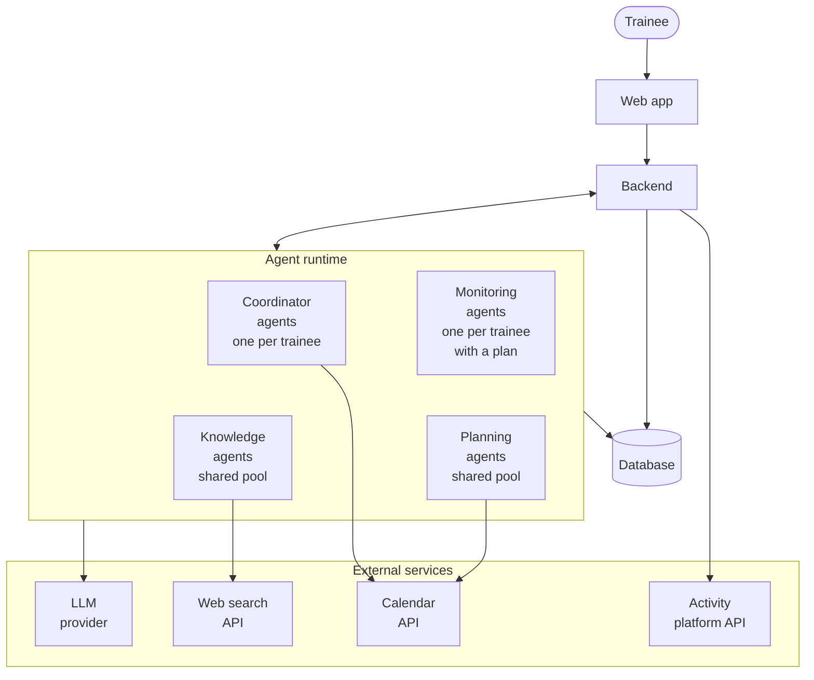

| Service | Called by | What for |
|---|---|---|
| Web app | backend | forms, decisions, showing proposals and messages |
| Activity platform API | backend | importing completed activities |
| LLM provider | all agents | reasoning, drafting plans, writing explanations |
| Web search API | knowledge agent | finding training guidance |
| Calendar API | planning agent | reading free/busy slots |
| Calendar API | coordinator agent | writing, updating and removing workout events |
| Database | backend and all agents | storing everything; each agent reads and writes the data its role permissions allow |

The backend:

- handles accounts, and runs the consent flow when the trainee connects the calendar or the activity platform. It stores the access tokens; agents use them when they call the calendar;
- imports completed activities. The activity platform notifies the backend about new activities, which then fetches them. This needs a public endpoint, and it has to work even while the trainee's monitoring agent is suspended, so it isn't done by an agent;
- turns outside events (a submitted form, a decision, a new activity, a survey answer) into messages for the right trainee's agents.

The agents only make decisions and produce content. They never talk to the trainee directly; all of that goes through the web app and the backend. From the agents' point of view, the outside services are part of the environment.

## 3. Requirements

### 3.1 Functional requirements

**Account, profile and goal**

- **FR-1.** The trainee can connect a calendar and an activity platform, and disconnect them at any time. Both connections are optional.
- **FR-2.** During onboarding the trainee enters: discipline, goal, target date, current level, weekly availability and any health limitations. All fields are required, and the web app doesn't accept an incomplete form.
- **FR-3.** A trainee has at most one active goal and one active plan at a time.

**Knowledge**

- **FR-4.** The system searches the web for training guidance that fits the trainee's discipline, goal, level and limitations.
- **FR-5.** Every source gets a credibility rating. Sources below a threshold are not used. Every piece of guidance keeps a reference to its source.
- **FR-6.** Research results are reused for the same trainee as long as they still cover the situation. New research happens only when they don't.

**Planning**

- **FR-7.** The system generates a full plan from the start date to the target date. Each workout has a date, type, duration, intensity and short description.
- **FR-8.** A plan never schedules a workout outside the trainee's declared availability. If a calendar is connected, it also never schedules one in a busy calendar slot.
- **FR-9.** The system proposes a plan change after a change report from the trainee or a significant deviation detected by monitoring.
- **FR-10.** If a change turns out to be unnecessary, the system says so instead of producing an empty proposal.

**Change reports**

- **FR-11.** The trainee can report a change at any time. There are three kinds: an availability change, a missed workout, and a health change (injury, illness or recovery, described in their own words).
- **FR-12.** The health change form always shows a fixed notice to seek medical help for serious symptoms. The system doesn't diagnose anything. Every proposal that follows a health change includes a disclaimer that it isn't medical advice.

**Explanations and decisions**

- **FR-13.** Every proposal comes with a plain-language explanation: what changed compared to the current plan, why, and which sources support it.
- **FR-14.** No plan and no change takes effect without the trainee's explicit acceptance.
- **FR-15.** If the trainee rejects a proposal, the current plan stays. During onboarding this means no plan is saved; the trainee can edit the profile and start again. After any rejection the trainee can submit a new change report.
- **FR-16.** All plan versions are stored, including rejected proposals. The trainee can browse the history of accepted versions together with their explanations.
- **FR-17.** If a calendar is connected, workouts from the accepted plan are written to it. When the plan changes, the calendar entries are updated or removed.

**Monitoring**

- **FR-18.** Completed activities are imported from the connected activity platform. The trainee can also enter activities manually.
- **FR-19.** After a workout, the trainee can fill in a short voluntary survey: perceived effort, fatigue, pain and notes.
- **FR-20.** New activity data and survey answers are compared with the plan as soon as they arrive. A significant deviation (with configurable thresholds) starts an adaptation. Smaller differences are ignored.

### 3.2 Non-functional requirements

- **NFR-1. Safety boundaries.** The system is not a medical device, and says so wherever it gives advice related to health. The MVP does not screen health reports for dangerous symptoms; the fixed notice from FR-12 is the only safeguard.
- **NFR-2. Privacy.** Health reports are special-category data under GDPR (art. 9) and need explicit consent. Integrations are opt-in and can be revoked. They request the narrowest scopes available: calendar free/busy, plus write access only to events created by the app. The trainee can export and delete their data.
- **NFR-3. Traceability.** Every plan version stores what triggered it, which sources it used, its explanation and the trainee's decision. It must be possible to answer "why does my plan look like this?" for any past version.
- **NFR-4. Responsiveness.** Preparing a proposal can take a while (web search plus several model calls). The web app shows progress while it happens. Target times are still to be agreed (section 9.1).
- **NFR-5. Scalability.** Knowledge and planning agents are stateless and run as pools that scale with load. Per-trainee agents can be suspended when idle and restored from the database.
- **NFR-6. Reliability.** No event from the trainee or an integration is lost. Events for one trainee are queued, and that trainee has at most one process running at a time. After a restart, agents continue from persisted state.
- **NFR-7. Failure handling.** A failure of an external service (web search, calendar, activity platform, LLM provider) never changes the current plan. The running process stops, and the trainee sees what didn't work.
- **NFR-8. Cost control.** Each process produces at most one proposal. Research is reused as described in FR-6.
- **NFR-9. Platform neutrality.** The design doesn't depend on a specific agent framework. Each protocol in section 4.3 is a request/reply or a one-way notification, so it maps onto any message-based runtime.
- **NFR-10. Understandability.** Explanations are written for beginners: no unexplained jargon, and each change is tied to a concrete reason.

## 4. Gaia analysis

### 4.1 Information used by the roles

The role permissions below refer to these pieces of information.

| Name                   | What it is                                                                                        | Where it lives                     |
| ---------------------- | ------------------------------------------------------------------------------------------------- | ---------------------------------- |
| `userId`               | Identifier of the trainee a role instance works for                                               | Supplied when the agent is created |
| `userInput`            | Whatever the trainee submitted in the web app: the onboarding form, a change report or a decision | Web app → backend                  |
| `profile`              | Discipline, goal, target date, level, weekly availability, health limitations                     | Database                           |
| `changeReport`         | Reported change (`kind`: availability, missedWorkout or health) and its description               | Database                           |
| `researchQuery`        | Discipline, goal, level, limitations, and what the research should focus on                       | Produced per request               |
| `webContent`           | Search results and pages                                                                          | Web search API                     |
| `knowledgeBrief`       | Guidance with source references and a credibility rating per source                               | Database                           |
| `minCredibility`       | Credibility threshold                                                                             | Configuration                      |
| `calendarAvailability` | Free/busy slots                                                                                   | Calendar API                       |
| `calendarEvents`       | Workout events the app created in the trainee's calendar                                          | Calendar API                       |
| `activityLog`          | Synced and manually entered activities                                                            | Database                           |
| `surveyResponses`      | Post-workout surveys                                                                              | Database                           |
| `currentPlan`          | Latest accepted plan version                                                                      | Database                           |
| `planHistory`          | All plan versions, including rejected proposals                                                   | Database                           |
| `trigger`              | What started the current process: `onboarding`, `changeReport` or `deviation`                     | Produced per process               |
| `proposal`             | Proposed plan version; `NULL` when no change is needed. `type`: new or modification               | Database                           |
| `explanation`          | Plain-language explanation of a proposal                                                          | Database                           |
| `medicalDisclaimer`    | Fixed text added to proposals that follow a health change                                         | Configuration                      |
| `userDecision`         | Accepted or rejected                                                                              | Database                           |
| `deviation`            | A significant difference between plan and execution                                               | Produced by `PROGRESSMONITOR`      |
| `deviationThresholds`  | When a difference counts as significant                                                           | Configuration                      |
| `message`              | Informational text for the trainee (no change needed, plan kept, no plan saved, confirmation)     | Produced per process               |

### 4.2 Roles model

There are five roles. The trainee is not a role and reaches the system only through the web app.

| Role                  | One-line description                                        |
| --------------------- | ----------------------------------------------------------- |
| `COORDINATOR`         | Talks to the trainee and runs each process for them         |
| `KNOWLEDGERESEARCHER` | Finds and rates training guidance on the web                |
| `PLANNER`             | Creates and modifies plans                                  |
| `EXPLAINER`           | Explains proposals in plain language                        |
| `PROGRESSMONITOR`     | Compares the plan with what the trainee actually did        |

#### Role schema: COORDINATOR

|                 |                                                                                                                                                                                                                                                                                                                                                                                                                                                                                                   |
| --------------- | ------------------------------------------------------------------------------------------------------------------------------------------------------------------------------------------------------------------------------------------------------------------------------------------------------------------------------------------------------------------------------------------------------------------------------------------------------------------------------------------------- |
| **Description** | The trainee's contact point and the manager of every process for that trainee. Picks up the onboarding form, change reports and decisions from the web app. Asks the knowledge researcher for guidance when needed, asks the planner for a proposal, shows it to the trainee, and saves a plan only after the trainee accepts it.                                                                                                                                                                 |
| **Protocols**   | `KnowledgeRequest`, `KnowledgeReply`, `PlanRequest`, `PlanReply`, `PlanUpdated`, `ReportDeviation`                                                                                                                                                                                                                                                                                                                                                                                                |
| **Activities**  | `ReceiveRequest`, `CheckBrief`, `PresentProposal`, `AwaitDecision`, `InformTrainee`, `CommitPlan`, `SyncCalendar`                                                                                                                                                                                                                                                                                                                                                                                 |
| **Permissions** | **reads supplied** `userId` **reads** `userInput`, `deviation`, `knowledgeBrief`, `proposal`, `explanation` **generates** `profile`, `changeReport`, `userDecision`, `researchQuery`, `trigger`, `message` **changes** `currentPlan`, `planHistory`, `calendarEvents`                                                                                                                                                                                                                 |
| **Liveness**    | `COORDINATOR = (Onboarding \| Adaptation)ω` `ONBOARDING = ReceiveRequest . ObtainKnowledge . Negotiate` `ADAPTATION = (ReceiveRequest \| ReportDeviation) . CheckBrief . [ObtainKnowledge] . Negotiate` `OBTAINKNOWLEDGE = KnowledgeRequest . KnowledgeReply` `NEGOTIATE = PlanRequest . PlanReply . (InformTrainee \| Decide)` `DECIDE = PresentProposal . AwaitDecision . (Commit \| InformTrainee)` `COMMIT = CommitPlan . SyncCalendar . PlanUpdated . InformTrainee` |
| **Safety**      | `activeProcesses(userId) ≤ 1` `trigger = onboarding ⇒ complete(profile)` `currentPlan changed ⇒ userDecision = accepted` `shown(proposal) ⇒ explanation ≠ NULL` `calendarEvents = workouts(currentPlan)`                                                                                                                                                                                                                                                                          |

Liveness, in plain words:

- The coordinator repeatedly runs either an onboarding or an adaptation, one after another, for as long as the trainee uses the system.
- Onboarding: take the form, get research, then negotiate a plan.
- Adaptation: start from a change report or a deviation, check whether the stored research still covers the situation, research more only if it doesn't, then negotiate.
- Negotiation: ask the planner. If it has nothing to propose, tell the trainee. Otherwise show the proposal and wait for a decision.
- After an acceptance, save the plan, update the calendar, tell the monitor about the new version and confirm to the trainee. After a rejection, tell the trainee the plan was kept (or that no plan was saved).

Safety, in plain words:

- Only one process runs at a time for a given trainee.
- Onboarding never starts with an incomplete profile.
- The plan only changes after the trainee accepts.
- A proposal is never shown without its explanation.
- The calendar always matches the accepted plan.

#### Role schema: KNOWLEDGERESEARCHER

| | |
|---|---|
| **Description** | Searches the web for training guidance that fits the query, rates each source's credibility, drops the weak ones and returns a brief with references. |
| **Protocols** | `KnowledgeRequest`, `KnowledgeReply` |
| **Activities** | `SearchWeb`, `RateSources`, `CompileBrief` |
| **Permissions** | **reads supplied** `researchQuery` **reads** `webContent`, `minCredibility` **generates** `knowledgeBrief` |
| **Liveness** | `KNOWLEDGERESEARCHER = (KnowledgeRequest . SearchWeb+ . RateSources . CompileBrief . KnowledgeReply)ω` |
| **Safety** | `∀ s ∈ sources(knowledgeBrief): credibility(s) ≥ minCredibility` `∀ c ∈ claims(knowledgeBrief): sources(c) ≠ ∅` |

Liveness, in plain words: for every request, search the web one or more times, rate the sources, put the brief together and send it back.

Safety, in plain words:

- Every source in the brief meets the credibility threshold.
- Every claim in the brief has at least one source.

#### Role schema: PLANNER

| | |
|---|---|
| **Description** | Builds the full plan up to the target date and modifies it when something changes, including health changes. Checks the hard constraints itself: declared availability and, if a calendar is connected, busy slots. It never returns a plan that breaks them. Before replying, it has the proposal explained by the explainer. |
| **Protocols** | `PlanRequest`, `PlanReply`, `ExplanationRequest`, `ExplanationReply` |
| **Activities** | `AssessImpact`, `DraftPlan`, `CheckConstraints` |
| **Permissions** | **reads supplied** `profile`, `trigger`, `changeReport` **reads** `currentPlan`, `knowledgeBrief`, `calendarAvailability`, `activityLog` **generates** `proposal` |
| **Liveness** | `PLANNER = (PlanRequest . [AssessImpact] . [(DraftPlan . CheckConstraints)+ . ExplanationRequest . ExplanationReply] . PlanReply)ω` |
| **Safety** | `proposal ≠ NULL ⇒ fits(proposal, profile.availability) ∧ fits(proposal, calendarAvailability)` `proposal ≠ NULL ⇒ proposal.end = profile.targetDate` `proposal ≠ NULL ⇒ explanation ≠ NULL` |

`AssessImpact` is skipped during onboarding, because there is no current plan yet. The constraint check is code, not a model call.

Liveness, in plain words: for every request, first decide whether the plan needs to change at all (except during onboarding). If it does, draft a plan and check it against the constraints, redrafting until it passes. Then have it explained and reply. If no change is needed, reply straight away with no proposal.

Safety, in plain words:

- A proposal always fits the declared availability and the free calendar slots.
- A proposal always runs up to the target date.
- A proposal is always sent back together with its explanation.

#### Role schema: EXPLAINER

| | |
|---|---|
| **Description** | Writes a plain-language explanation of a proposal: what changed compared to the current plan, why, and which sources support it. Adds the medical disclaimer when the proposal follows a health change. |
| **Protocols** | `ExplanationRequest`, `ExplanationReply` |
| **Activities** | `CompareVersions`, `WriteExplanation` |
| **Permissions** | **reads supplied** `proposal`, `trigger` **reads** `currentPlan`, `knowledgeBrief`, `medicalDisclaimer` **generates** `explanation` |
| **Liveness** | `EXPLAINER = (ExplanationRequest . [CompareVersions] . WriteExplanation . ExplanationReply)ω` |
| **Safety** | `∀ ch ∈ diff(currentPlan, proposal): covers(explanation, ch)` `sources(explanation) ⊆ sources(knowledgeBrief)` `changeReport.kind = health ⇒ contains(explanation, medicalDisclaimer)` |

Liveness, in plain words: for every request, compare the proposal with the current plan (when there is one), write the explanation and send it back.

Safety, in plain words:

- Every change in the proposal is explained.
- The explanation cites only sources the knowledge researcher provided.
- A proposal that follows a health change always carries the medical disclaimer.

#### Role schema: PROGRESSMONITOR

| | |
|---|---|
| **Description** | Watches one trainee's accepted plan. Compares it with synced activities, manual entries and survey answers as they arrive, and reports significant deviations straight away. |
| **Protocols** | `PlanUpdated`, `ReportDeviation` |
| **Activities** | `AwaitActivityData`, `CompareWithPlan` |
| **Permissions** | **reads supplied** `currentPlan` **reads** `activityLog`, `surveyResponses`, `deviationThresholds` **generates** `deviation` |
| **Liveness** | `PROGRESSMONITOR = PlanUpdated . ((PlanUpdated)ω \|\| (Observe)ω)` `OBSERVE = AwaitActivityData . CompareWithPlan . [ReportDeviation]` |
| **Safety** | `deviation ≠ NULL ⇒ exceeds(deviation, deviationThresholds)` |

Liveness, in plain words: the monitor starts when the first plan is accepted. From then on it does two things in parallel, forever: it swaps in each new plan version it is told about, and it compares every new piece of activity data with the plan, reporting a deviation when there is one.

Safety, in plain words: only differences above the configured thresholds are reported.

### 4.3 Interaction model

| Protocol | Purpose | Initiator | Responder | Inputs | Outputs | Processing |
|---|---|---|---|---|---|---|
| `KnowledgeRequest` | Ask for training guidance | `COORDINATOR` | `KNOWLEDGERESEARCHER` | `researchQuery` | – | Researcher searches, rates and compiles |
| `KnowledgeReply` | Return the guidance | `KNOWLEDGERESEARCHER` | `COORDINATOR` | `knowledgeBrief` | – | Brief is stored for later reuse |
| `PlanRequest` | Ask for a new plan or a change | `COORDINATOR` | `PLANNER` | `profile`, `trigger`, `changeReport` or `deviation`, `currentPlan`, `knowledgeBrief` | – | Planner assesses, drafts and checks |
| `PlanReply` | Return the result | `PLANNER` | `COORDINATOR` | `proposal` (or `NULL`), `explanation` | – | `NULL` means no change is needed |
| `ExplanationRequest` | Ask for an explanation of a proposal | `PLANNER` | `EXPLAINER` | `proposal`, `currentPlan`, `trigger`, `knowledgeBrief` | – | Explainer compares versions and writes the text |
| `ExplanationReply` | Return the explanation | `EXPLAINER` | `PLANNER` | `explanation` | – | Attached to the plan reply |
| `PlanUpdated` | Tell the monitor which plan version to track | `COORDINATOR` | `PROGRESSMONITOR` | `currentPlan` | – | Monitor replaces the tracked version |
| `ReportDeviation` | Report a significant deviation | `PROGRESSMONITOR` | `COORDINATOR` | `deviation` | – | Starts an adaptation (process 2) |

## 5. Gaia design

### 5.1 Agent model

Roles are grouped into four agent types. The planning agent plays two roles: an explanation is always needed right after a plan is drafted, so keeping both in one agent saves a round trip through the coordinator. The roles stay separate so that each has its own responsibilities and safety conditions.

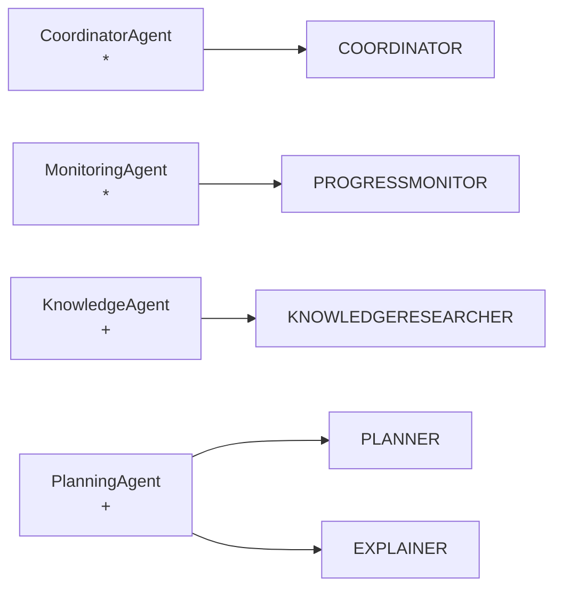

| Agent type         | Roles                   | Instances                                  | Why                                                                                        |
| ------------------ | ----------------------- | ------------------------------------------ | ------------------------------------------------------------------------------------------ |
| `CoordinatorAgent` | `COORDINATOR`           | `*`: one per registered trainee            | Holds the trainee's process state and serialises their events. Can be suspended when idle. |
| `MonitoringAgent`  | `PROGRESSMONITOR`       | `*`: one per trainee with an accepted plan | Watches one trainee's data                                                                 |
| `KnowledgeAgent`   | `KNOWLEDGERESEARCHER`   | `+`: shared pool                           | Stateless; scaled with load                                                                |
| `PlanningAgent`    | `PLANNER`, `EXPLAINER`  | `+`: shared pool                           | Stateless; scaled with load                                                                |

Mixing per-trainee agents with shared pools avoids the problems of the two simpler arrangements:

- **Fully shared agents:** one coordinator would become a bottleneck and a single point of failure, and per-trainee state would have to be loaded on every message.
- **A full set of agents per trainee:** the number of mostly idle agents would grow with the number of trainees, and research results wouldn't be reused.

The cost is two agent lifecycles to manage. Every request to a shared agent must also carry all the context it needs.

### 5.2 Services model

**CoordinatorAgent**

| Service          | Inputs                                                | Outputs                                        | Pre-condition                                       | Post-condition                                                    |
| ---------------- | ----------------------------------------------------- | ---------------------------------------------- | --------------------------------------------------- | ----------------------------------------------------------------- |
| receive request  | `userInput`                                           | `profile` / `changeReport`, `trigger`          | true                                                | process started, or queued if one is running                      |
| obtain knowledge | `researchQuery`                                       | `knowledgeBrief`                               | `knowledgeBrief = NULL ∨ ¬covers(knowledgeBrief, trigger)` | `knowledgeBrief ≠ NULL`                                    |
| get decision     | `proposal`, `explanation`                             | `userDecision`                                 | `proposal ≠ NULL ∧ explanation ≠ NULL`              | `userDecision ≠ NULL`                                             |
| commit plan      | `proposal`, `userDecision`                            | `currentPlan`, `planHistory`, `calendarEvents` | `userDecision = accepted`                           | `currentPlan = proposal ∧ calendarEvents = workouts(currentPlan)` |
| inform trainee   | `message`                                             | –                                              | true                                                | trainee has seen `message`                                        |

**KnowledgeAgent**

| Service | Inputs | Outputs | Pre-condition | Post-condition |
|---|---|---|---|---|
| research training guidance | `researchQuery` | `knowledgeBrief` | `researchQuery ≠ NULL` | `∀ s ∈ sources(knowledgeBrief): credibility(s) ≥ minCredibility` |

**PlanningAgent**

| Service | Inputs | Outputs | Pre-condition | Post-condition |
|---|---|---|---|---|
| assess impact | `trigger`, `currentPlan`, `activityLog` | change needed (yes/no) | `currentPlan ≠ NULL` | decision made |
| produce plan proposal | `profile`, `trigger`, `currentPlan`, `knowledgeBrief`, `calendarAvailability` | `proposal` | `profile` complete | `fits(proposal, profile.availability) ∧ fits(proposal, calendarAvailability) ∧ proposal.end = profile.targetDate` |
| explain proposal | `proposal`, `currentPlan`, `trigger`, `knowledgeBrief` | `explanation` | `proposal ≠ NULL` | `∀ ch ∈ diff(currentPlan, proposal): covers(explanation, ch) ∧ sources(explanation) ⊆ sources(knowledgeBrief)` |

**MonitoringAgent**

| Service | Inputs | Outputs | Pre-condition | Post-condition |
|---|---|---|---|---|
| track plan | `currentPlan` | – | `userDecision = accepted` | monitor tracks the latest accepted version |
| detect deviation | `activityLog`, `surveyResponses`, `currentPlan`, `deviationThresholds` | `deviation` | `currentPlan ≠ NULL` | `deviation = NULL ∨ exceeds(deviation, deviationThresholds)` |

### 5.3 Acquaintance model

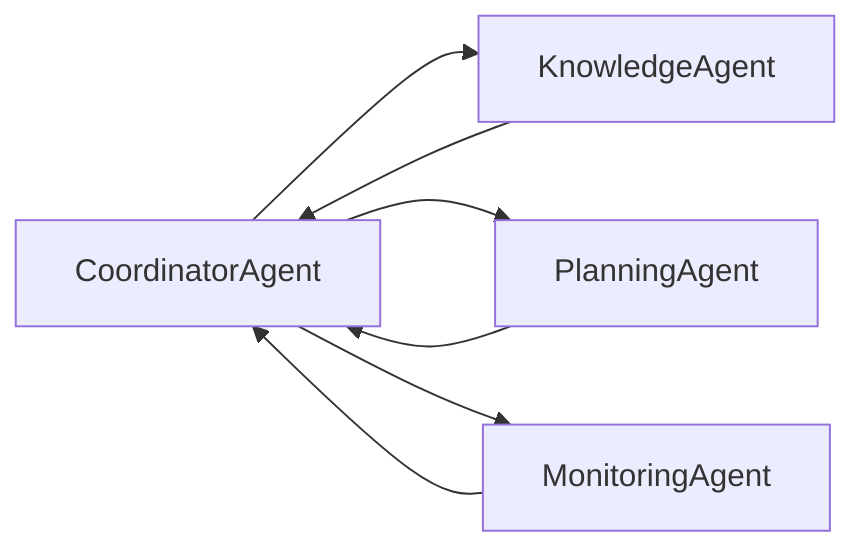

The other agents never talk to each other, only to the coordinator. Because there is one coordinator per trainee, the hub isn't shared between trainees. The shared resources are the stateless knowledge and planning pools. The planner and the explainer talk to each other inside the planning agent.

## 6. Processes (BPMN 2.0)

Each process is described by a choreography, a BPMN collaboration diagram and one flowchart per agent. The collaboration diagrams are stored as `.bpmn` files in [`bpmn/`](bpmn/), each with an SVG rendering next to it. In the per-agent flowcharts, `→ X` marks a message sent to X, `← X` a message received from X, and `↔ X` a request with a reply.

### 6.1 Conversation diagram

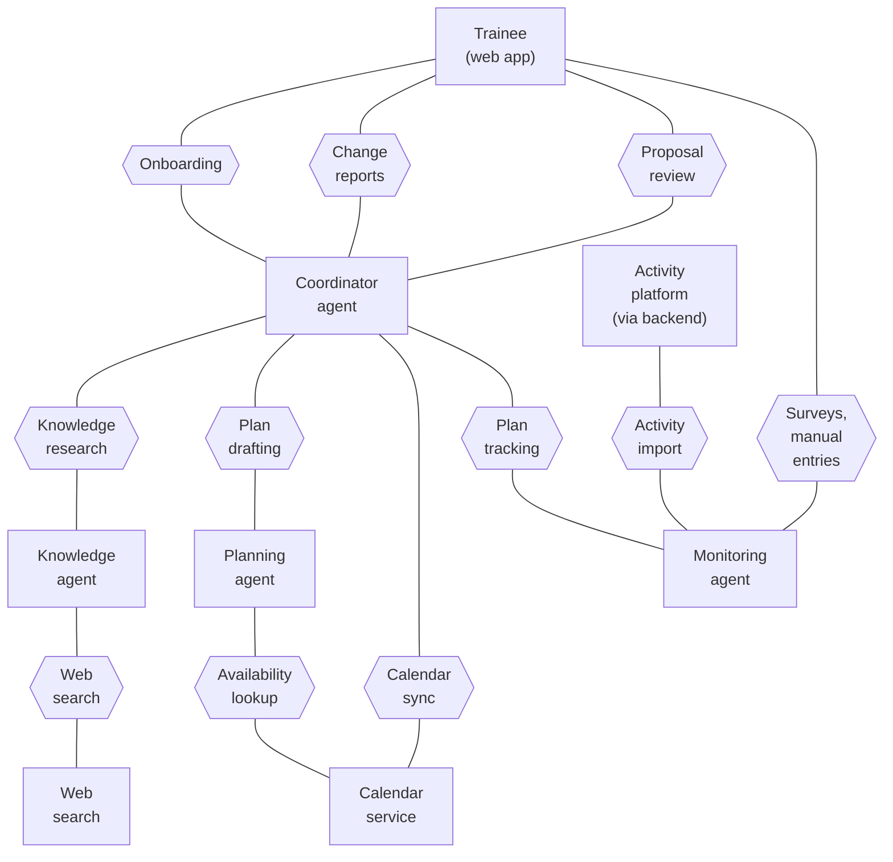

"Plan tracking" groups `PlanUpdated` and `ReportDeviation`. "Proposal review" covers showing a proposal, the trainee's decision and the informational messages.

### 6.2 Process 1: Onboarding and initial plan

The trainee fills in the onboarding form. The knowledge agent researches the discipline and goal. The planner drafts the full plan, reading the calendar and checking hard constraints, and the explainer writes the explanation. If the trainee accepts, the plan is saved, written to the calendar and handed to a new monitoring agent. If they reject it, nothing is saved and they can edit the profile and start again.

**Choreography**

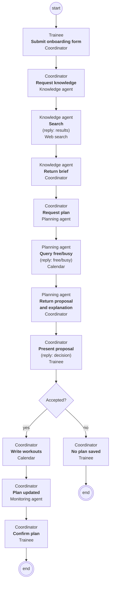

**Collaboration.** BPMN file: [`bpmn/1-onboarding.bpmn`](bpmn/1-onboarding.bpmn).

*Coordinator agent*

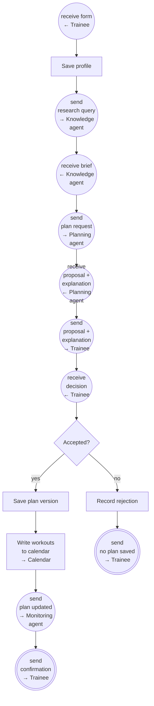

*Knowledge agent*

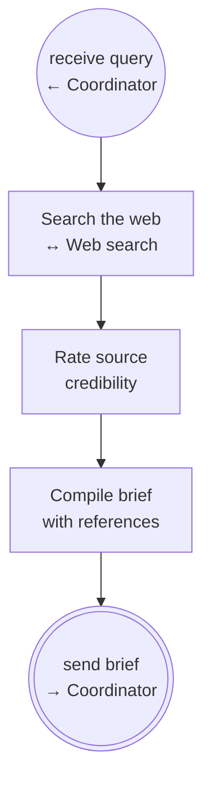

*Planning agent*

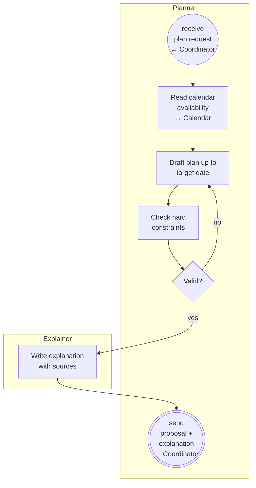

### 6.3 Process 2: Plan adaptation after a change

There are two triggers:

- the trainee reports a change: an availability change, a missed workout, or a health change (injury, illness or recovery);
- the monitoring agent reports a significant deviation.

If the stored knowledge brief doesn't cover the new situation, the coordinator asks for more research first. The planner then assesses the impact on the plan. If no change is needed, the trainee is told so. Otherwise the planner drafts a modification and the explainer explains it; after a health change the explanation includes the medical disclaimer. The trainee accepts or rejects it. On rejection the current plan stays. In the BPMN diagram the knowledge agent is shown as a black box; its insides are the same as in process 1.

**Choreography**

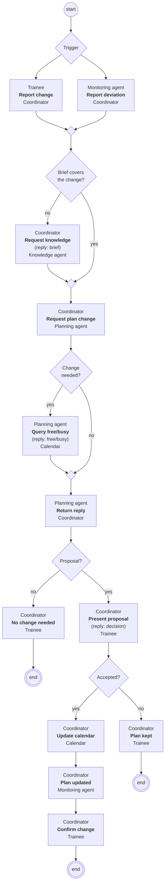

**Collaboration.** BPMN file: [`bpmn/2-adaptation.bpmn`](bpmn/2-adaptation.bpmn).

*Coordinator agent*

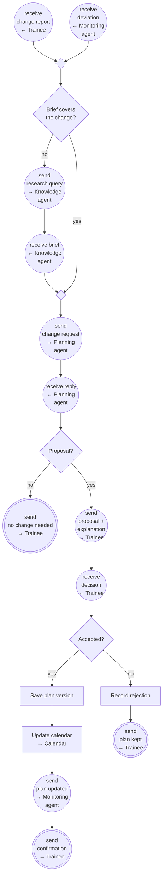

*Planning agent*

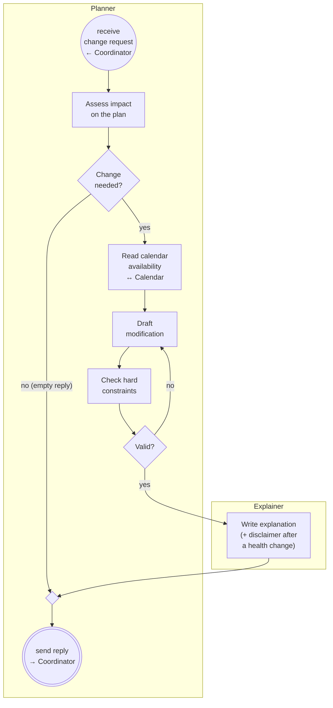

The knowledge agent works the same way as in process 1.

### 6.4 Process 3: Progress monitoring

The monitoring agent starts when a plan is first accepted, and then waits for one of three events:

- **A plan update:** it loads the new version.
- **A synced activity:** the backend imports it from the activity platform and passes it on; the monitor compares it with the plan.
- **A survey answer or manual entry:** it compares it with the plan.

If the difference is above the thresholds, the monitor reports a deviation to the coordinator, which starts process 2. Smaller differences are ignored. In the BPMN diagram the coordinator is shown as a black box.

**Choreography**

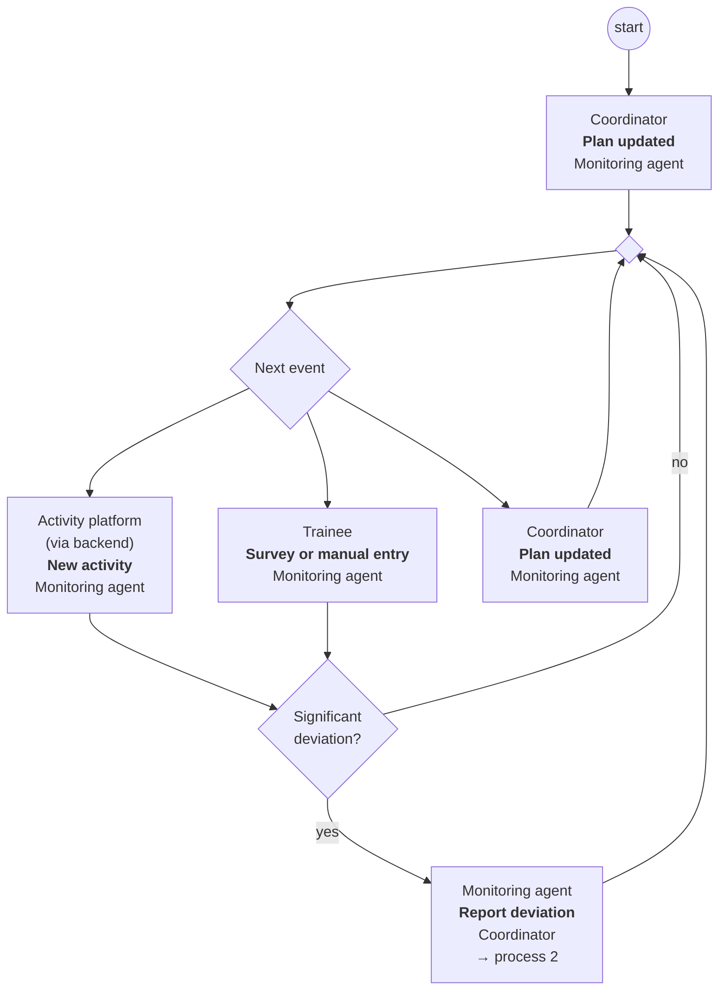

**Collaboration.** BPMN file: [`bpmn/3-monitoring.bpmn`](bpmn/3-monitoring.bpmn).

*Monitoring agent*

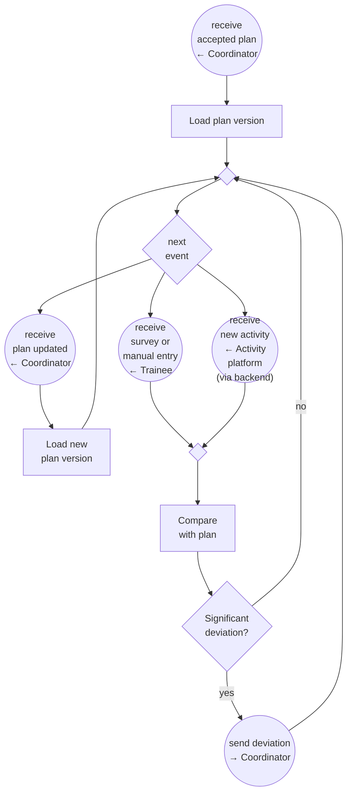

## 7. Data model

Proposals are stored as plan versions with status `proposed`. Accepting one turns it into `accepted` and the previous version into `superseded`. Rejecting it sets `rejected`. This keeps a full record of what was proposed and decided (NFR-3). The profile is stored on the trainee, and the explanation on the plan version.

The model is shown in two diagrams. `TRAINEE` and `WORKOUT` appear in both; their attributes are listed in the first one.

**Plans and knowledge**

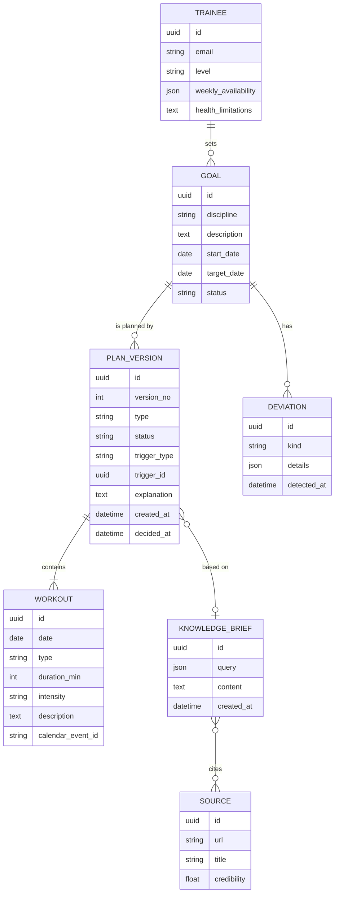

**Integrations, reports and activities**

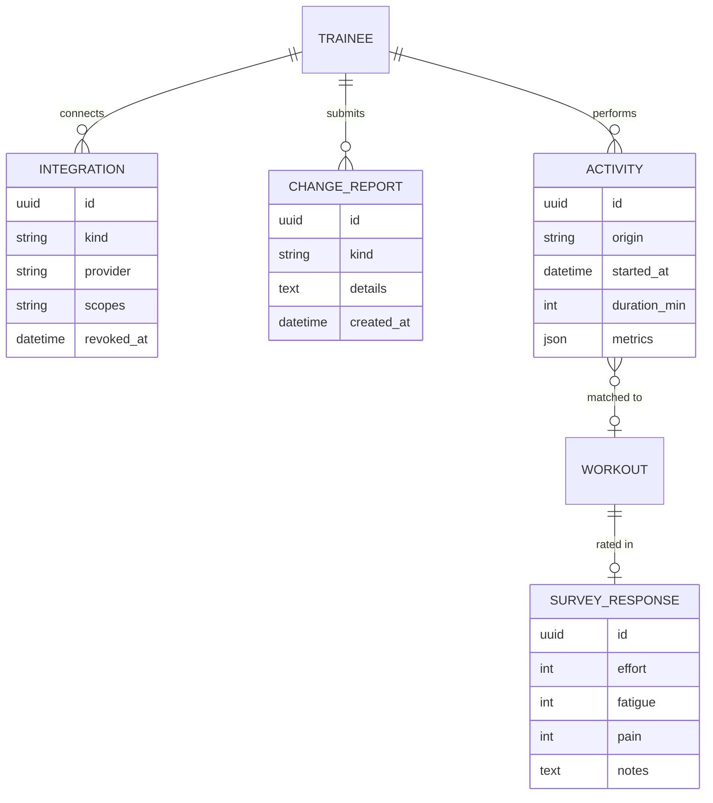

Allowed values:

- `GOAL.status`: active, closed
- `PLAN_VERSION.type`: new, modification
- `PLAN_VERSION.status`: proposed, accepted, rejected, superseded
- `PLAN_VERSION.trigger_type`: onboarding, change_report, deviation
- `INTEGRATION.kind`: calendar, activity
- `CHANGE_REPORT.kind`: availability, missed_workout, health
- `ACTIVITY.origin`: platform, manual

## 8. Risks and limitations

- **Plan quality.** The planner and the knowledge researcher are model-based. A plan can satisfy every hard constraint and still be poor training. Nothing in this design measures training quality; that needs a review by someone qualified, such as a coach.
- **No independent plan review.** Hard constraints are checked inside the planner, and there is no separate reviewer. The only defence against a bad plan is the planner's own check plus the trainee's decision. The check should be deterministic code, not another model call. Otherwise it isn't really a check.
- **Source credibility is rated by a model.** The ratings are a filter, not a guarantee. A confident, well-written but wrong page can still get through.
- **No screening of health reports.** A trainee can describe a serious symptom and the planner will still only adapt the plan. The fixed notice on the form and the disclaimer on the proposal are the only safeguards in the MVP. This is the most important gap to close after the MVP (section 9.2).
- **One proposal per request.** After a rejection the trainee has to submit a new change report to get another proposal. This is simple, but it can be frustrating when a proposal is almost right.
- **Incomplete or contradictory profiles.** Required fields guarantee the form is filled in, not that it makes sense (for example, a target date too close for the goal). The planner has to cope with that on its own.
- **A full plan up front goes stale.** Generating the whole plan to the target date means later weeks are planned on assumptions that will change. Expect frequent modifications, and therefore model costs, especially for long goals.
- **Sparse feedback.** Surveys are voluntary, so for trainees without a connected activity platform, monitoring may have very little to work with.
- **Small deviations add up.** Only differences above the thresholds are acted on. Several small ones in a row are never picked up, because there is no periodic review in the MVP.
- **Many disciplines.** A discipline-agnostic system will be uneven: better for popular sports with plenty of good material online, worse for niche ones.
- **Integration limits.** Calendar and activity platform APIs have rate limits, permission models and outages outside our control. NFR-7 limits the damage, but some processes will fail for reasons the trainee can't fix.
- **Two agent lifecycles.** Per-trainee coordinator and monitoring agents have to be created, suspended, restored and removed correctly. Getting that wrong leads to lost events or duplicate processing.

## 9. Open questions

### 9.1 Questions about the MVP

- **Deviation thresholds:** what counts as a significant deviation? Examples: number of missed workouts in a row, volume below a percentage of the plan, or a reported pain level.
- **Credibility:** how is credibility rated and what is `minCredibility`? Is there an allow-list or block-list of sources?
- **Health changes:** how should the planner adjust the plan after an injury or illness report? What should the medical disclaimer say, and who reviews it?
- **Calendar vs. declared availability:** what happens when they conflict, and what happens when the calendar can't be read at all?
- **Response times:** what is the target response time for generating a proposal?
- **Lifecycle of per-trainee agents:** when is an idle coordinator suspended? What happens to the monitoring agent when a goal is closed?
- **End of the plan:** what happens at the target date? Currently out of scope.
- **Agent platform:** which agent platform will be used? The design is neutral, but the choice affects how protocols and agent lifecycles are implemented.

### 9.2 After the MVP

These features are not part of the MVP. For each, the open question is whether and when to add it.

- **Dedicated health process.** Every injury or illness report would be checked for red-flag symptoms (for example chest pain, fainting, shortness of breath at rest, sharp pain, a suspected fracture). A red flag would lead to a proposal to suspend the plan and see a doctor; no other training would be proposed while it stands. Without red flags, the system would propose a reduced plan with a disclaimer. After a suspension, a recovery report with confirmed medical clearance would lead to a return-to-training plan. Open points: who maintains the red-flag list, what "reduced" means, and what happens if the trainee declines a suspension.
- **Weekly review.** Every Sunday evening the monitor would send a summary of the past week (planned vs. done), and the planner would propose an adjustment for the coming week where needed. This would catch the small deviations the MVP ignores.
- **Follow-up questions about the profile.** A separate check would look for missing or contradictory information and ask the trainee follow-up questions instead of assuming values.
- **Revised proposals after a rejection.** The trainee would give a reason for rejecting, and the planner would try again with it, up to a configurable number of attempts.
- **Separate roles inside the coordinator.** Talking to the trainee, running processes and checking the profile could be three roles in one agent. This is worth doing once the profile check is added.
- **Separate explanation agent.** If explanations turn out to need different scaling or a different model than planning, the explainer can move to its own agent pool.
