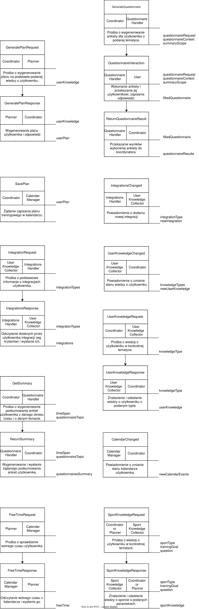
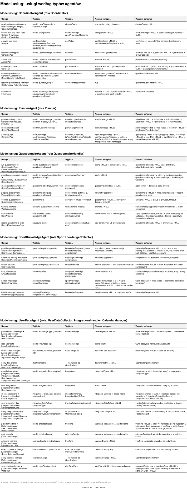
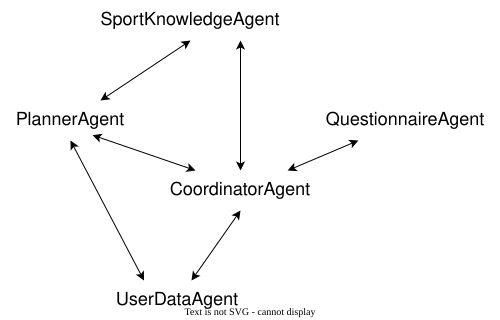
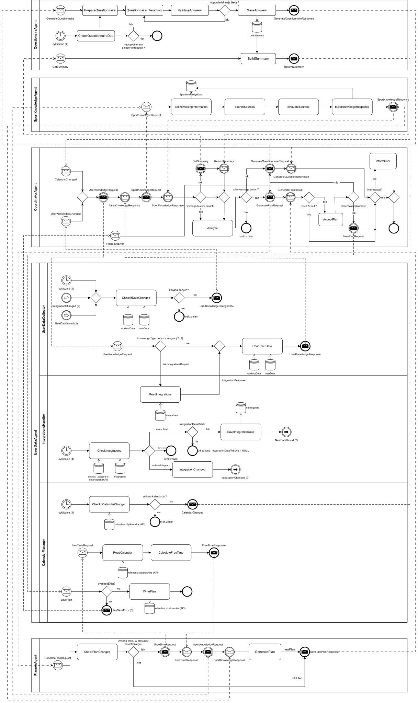

# Projekt systemu wieloagentowego – Inteligentny Asystent Treningowy (Gaia + BPMN)
*Autorzy: Antoni Pękała, Natalia Prokopiuk, Julian Uziembło, Franciszek Zarębski*

## 1. Wprowadzenie i cel systemu

Celem projektu jest opracowanie architektury systemu wieloagentowego wspierającego użytkownika w planowaniu, monitorowaniu oraz adaptacji treningów sportowych. System integruje dane z zewnętrznych aplikacji i urządzeń sportowych, zarządza kalendarzem użytkownika, przeprowadza okresowe i kontekstowe ankiety oraz gromadzi zweryfikowaną wiedzę dziedzinową o sporcie, aby generować bezpieczne i spersonalizowane plany treningowe.

Projekt został zrealizowany w oparciu o metodykę **Gaia** (obejmującą modele ról, interakcji, agentów oraz usług) oraz uzupełniony diagramem procesów biznesowych **BPMN**, obrazującym szczegółową choreografię i orkiestrację komunikatów pomiędzy uczestnikami systemu.

---

## 2. Wymagania funkcjonalne

| ID | Nazwa wymagania | Opis | Powiązane role |
| :--- | :--- | :--- | :--- |
| RF-01 | Definiowanie profilu i celów treningowych użytkownika | Użytkownik może określić dyscyplinę sportową, poziom zaawansowania, aktualne możliwości i cele treningowe. System zapisuje te informacje i pozwala je później zmieniać. | Coordinator |
| RF-02 | Określanie dostępności i ograniczeń treningowych | Użytkownik może wskazać, w jakie dni i jak długo może trenować, a także określić swoje ograniczenia. System może również pobierać informacje o dostępności z kalendarza, np. Google Calendar. | CalendarManager |
| RF-03 | Pozyskiwanie danych o aktywności i samopoczuciu użytkownika | System zbiera informacje o wykonanych i pominiętych treningach, aktywności oraz samopoczuciu użytkownika na podstawie krótkich ankiet i danych z podłączonych aplikacji lub urządzeń sportowych. Zapisuje te informacje i wykorzystuje je do planowania treningów, analizy postępów oraz dostosowywania planu. | QuestionnaireHandler, IntegrationsHandler, UserDataCollector |
| RF-04 | Pozyskiwanie i przechowywanie wiedzy treningowej | System wyszukuje informacje dotyczące wybranej dyscypliny i celu treningowego, korzystając z profesjonalnych źródeł, takich jak publikacje naukowe czy materiały specjalistów. Zapisuje zdobytą wiedzę wraz z linkami do źródeł, aby można było ją później wykorzystać i zweryfikować. | SportKnowledgeCollector |
| RF-05 | Generowanie spersonalizowanego planu treningowego | System tworzy plan treningowy dopasowany do celów, poziomu zaawansowania, dostępnego czasu i możliwości użytkownika. Uwzględnia przy tym historię aktywności oraz zgromadzoną wiedzę treningową. | Planner |
| RF-06 | Wyjaśnianie planu treningowego na podstawie źródeł | System wyjaśnia, dlaczego zaproponował konkretne treningi, ich intensywność i częstotliwość. Uzasadnia swoje decyzje na podstawie zgromadzonej wiedzy i wskazuje źródła, z których korzystał. | Coordinator |
| RF-07 | Prezentowanie i akceptowanie zmian w planie (UI) | System udostępnia interfejs, w którym użytkownik może przeglądać swój plan treningowy oraz proponowane zmiany. Przed wprowadzeniem zmian przedstawia ich uzasadnienie i umożliwia użytkownikowi ich zaakceptowanie lub odrzucenie. | Coordinator |
| RF-08 | Analiza postępów | System analizuje historię aktywności użytkownika, aby ocenić jego postępy w realizacji celów treningowych. Bierze pod uwagę dostępne dane, takie jak wykonane treningi, ich intensywność i zmiany wyników. | Coordinator, UserDataCollector |
| RF-09 | Wykrywanie zmian wymagających dostosowania planu | System monitoruje realizację planu i wykrywa sytuacje, w których może być potrzebna jego modyfikacja, np. pominięcie treningu, zmiana dostępności lub pogorszenie samopoczucia. Na tej podstawie decyduje, czy należy przygotować nową propozycję planu. | Coordinator, Planner |
| RF-10 | Analiza przyczyn odrzucenia planu | Jeśli użytkownik odrzuci zaproponowany plan lub jego zmianę, system pyta o powód tej decyzji. Zapisuje otrzymaną informację i wykorzystuje ją przy przygotowywaniu kolejnych propozycji, aby lepiej dopasować je do oczekiwań użytkownika. | Coordinator |

---

## 3. Faza Analizy

### 3.1. Model Ról

W systemie wyodrębniono **7 wyspecjalizowanych ról**, z których każda posiada ściśle określony zakres odpowiedzialności, uprawnienia do zasobów oraz reguły żywotności (*Liveness*) i bezpieczeństwa (*Safety*).

#### 1. `COORDINATOR`
* **Opis:** Koordynuje działanie aplikacji; analizuje stan wiedzy o użytkowniku i sporcie, a na tej podstawie podejmuje decyzje o dalszych krokach (wygenerowanie planu, zlecenie ankiety lub brak zmian).
* **Protokoły i aktywności:** `UserKnowledgeChanged`, `CalendarChanged`, `GetUserKnowledge`, `GetSportKnowledge`, `GeneratePlan`, `GenerateQuestionnaire`, `ReturnQuestionnaireResult`, `GetSummary`, `ReturnSummary`, `AcceptPlan`, `SavePlan`, `Analyze`, `InformUser`.
* **Uprawnienia (`Permissions`):**
  * `reads`: `sportKnowledge`, `userKnowledge`, `userPlan`, `supplied planDecision`
* **Odpowiedzialności:**
  * *Liveness:* `Coordinator = (AwaitChange . AnalyzeUserState . DecideWhatNext . [InformUser])^ω`
  * *Safety:* `planDecision ≠ accepted ⇒ SavePlan` nie jest wykonywane (plan trafia do kalendarza użytkownika wyłącznie po jego akceptacji).

#### 2. `PLANNER`
* **Opis:** Generuje bezpieczne i wykonalne plany treningowe użytkownika z uzasadnieniem oraz odwołaniami do źródeł.
* **Protokoły i aktywności:** `GetFreeTime`, `GetSportKnowledge`, `GeneratePlanRequest`, `GeneratePlanResponse`, `CheckPlanChanged`, `GeneratePlan`.
* **Uprawnienia (`Permissions`):**
  * `reads`: `supplied userKnowledge`, `sportKnowledge`
  * `generates`: `userPlan`, `planRationale`, `sourceReferences`, `isPlanSafe`, `isPlanPossible`
* **Odpowiedzialności:**
  * *Liveness:* `Planner = (GeneratePlanRequest . MakePlan . GeneratePlanResponse)^ω`
  * *Safety:* `isPlanSafe = false ⇒ plan = NULL` oraz `isPlanPossible = false ⇒ plan = NULL`.

#### 3. `CALENDARMANAGER`
* **Opis:** Zarządza kalendarzem użytkownika (odczyt wydarzeń, obliczanie okien wolnego czasu, zapis zaakceptowanego planu).
* **Protokoły i aktywności:** `CalendarChanged`, `FreeTimeRequest`, `FreeTimeResponse`, `SavePlan`, `CheckIfPlanChanged`, `ReadCalendar`, `CalculateFreeTime`, `WritePlan`.
* **Uprawnienia (`Permissions`):**
  * `reads`: `supplied userPlan`
  * `changes`: `trainingPlan`
* **Odpowiedzialności:**
  * *Liveness:* `CalendarManager = (CheckIfPlanChanged | SupplyRequestedData | ChangeCalendar)^ω`
  * *Safety:* `overlapExist = true ⇒ planSaveError` (zabezpieczenie przed nadpisaniem istniejących wydarzeń w kalendarzu).

#### 4. `SPORTKNOWLEDGECOLLECTOR`
* **Opis:** Pozyskuje (lokalnie lub online), ocenia i przechowuje wiedzę treningową dotyczącą dyscypliny i celu użytkownika, udostępniając ją Koordynatorowi i Planerowi wraz ze źródłami i ograniczeniami.
* **Protokoły i aktywności:** `SportKnowledgeRequest`, `SportKnowledgeResponse`, `DefineMissingInformation`, `SearchSources`, `EvaluateSources`, `BuildKnowledgeResponse`.
* **Uprawnienia (`Permissions`):**
  * `reads`: `supplied sport`, `trainingGoal`, `question`, `sourceMaterials`, `knowledgeSettings`
  * `changes`: `sportKnowledge`
  * `generates`: `knowledgeResponse`, `sourceReferences`, `refreshResult`
* **Odpowiedzialności:**
  * *Liveness:* `SportKnowledgeCollector = (SportKnowledgeRequest . DefineMissingInformation . SearchSources . EvaluateSources . BuildKnowledgeResponse . SportKnowledgeResponse)^ω`
  * *Safety:* Zapis do `sportKnowledge` wymaga ocenionych źródeł, zakresu zastosowania i daty sprawdzenia; błąd wyszukiwania lub zapisu zachowuje poprzednią zawartość bazy.

#### 5. `USERDATACOLLECTOR`
* **Opis:** Dostarcza skondensowaną wiedzę o użytkowniku na żądanie oraz informuje Koordynatora o zmianach jej stanu.
* **Protokoły i aktywności:** `UserDataChanged`, `UserKnowledgeRequest`, `UserKnowledgeResponse`, `CheckIfDataChanged`, `ReadUserData`.
* **Uprawnienia (`Permissions`):**
  * `reads`: `workoutData`, `userData`, `supplied knowledgeType`
  * `generates`: `dataChangeInfo`
* **Odpowiedzialności:**
  * *Liveness:* `UserDataCollector = (HandleChangedData | SupplyRequestedData)^ω`
  * *Safety:* `true`

#### 6. `QUESTIONNAIREHANDLER`
* **Opis:** Zbiera informacje o realizacji treningów, samopoczuciu i powodach odrzucenia planu poprzez ankiety okresowe i kontekstowe; waliduje odpowiedzi, zapisuje je i generuje podsumowania historyczne.
* **Protokoły i aktywności:** `GenerateQuestionnaireRequest`, `QuestionnaireInteraction`, `GenerateQuestionnaireResponse`, `GetSummary`, `ReturnSummary`, `CheckQuestionnaireDue`, `PrepareQuestionnaire`, `ValidateAnswers`, `SaveAnswers`, `BuildSummary`.
* **Uprawnienia (`Permissions`):**
  * `reads`: `supplied questionnaireRequest...`, `questionnaireSettings...`
  * `generates`: `questionnaire`, `questionnaireResult...`
  * `changes`: `userData` (wyłącznie część ankietowa)
* **Odpowiedzialności:**
  * *Liveness:* `QuestionnaireHandler = (QuestionnaireTask | SummaryTask)^ω`
  * *Safety:* Brak odpowiedzi lub odmowa skutkuje zapisem wyłącznie statusu i metadanych (bez domyślnych deklaracji o treningu); podsumowanie wynika wyłącznie z historii ankiet w zadanym zakresie.

#### 7. `INTEGRATIONSHANDLER`
* **Opis:** Zarządza połączeniami z zewnętrznymi aplikacjami i urządzeniami sportowymi (np. Strava, Google Fit, Smartwatch), synchronizuje nowe dane treningowe oraz informuje o dodaniu lub usunięciu integracji.
* **Protokoły i aktywności:** `IntegrationChanged`, `IntegrationsRequest`, `IntegrationsResponse`, `CheckIntegrations`, `SaveIntegrationData`, `ReadIntegrations`.
* **Uprawnienia (`Permissions`):**
  * `reads`: `supplied integrationType`
  * `changes`: `trainingData`, `integrations`
* **Odpowiedzialności:**
  * *Liveness:* `IntegrationsHandler = ((CheckIntegrations . [SaveIntegrationData] . [IntegrationChanged]) | SupplyRequestedData)^ω`
  * *Safety:* `integrationDataValid = false ⇒ integrationDataToSave = NULL`.

---

---

### 3.2. Model Interakcji

---

---

## 4. Faza Projektowania

### 4.1. Model Agentów

W procesie mapowania ról na typy agentów zastosowano dekompozycję 1:1 dla głównych komponentów logicznych oraz agregację trzech ról odpowiedzialnych za źródła danych użytkownika w jednego wyspecjalizowanego agenta domenowego (`UserDataAgent`):

| Typ Agenta | Przypisane Role | Krotność instancji | Uzasadnienie architektoniczne |
| :--- | :--- | :---: | :--- |
| **`CoordinatorAgent`** | `Coordinator` | `+` (1 lub więcej) | Centralny punkt decyzyjny obsługujący sesje i stan użytkowników. |
| **`PlannerAgent`** | `Planner` | `1..5` | Pula agentów planujących pozwalająca na skalowanie obliczeniowe generowania planów. |
| **`QuestionnaireAgent`** | `QuestionnaireHandler` | `1` | Pojedynczy moduł zarządzający harmonogramem ankiet, interakcją i historią odpowiedzi. |
| **`SportKnowledgeAgent`** | `SportKnowledgeCollector` | `1` | Wspólna baza wiedzy dziedzinowej i moduł wyszukiwania źródeł dla całego systemu. |
| **`UserDataAgent`** | `UserDataCollector` `IntegrationsHandler` `CalendarManager` | `1` | Agregacja ról operujących bezpośrednio na danych użytkownika, jego kalendarzu oraz zewnętrznych API (Strava, Google Fit) ogranicza narzut komunikacji sieciowej przy częstej synchronizacji danych. |

---

---

### 4.2. Model Usług

Poniżej zestawiono kluczowe usługi udostępniane przez poszczególne typy agentów wraz z ich warunkami wstępnymi (*Pre-conditions*) i końcowymi (*Post-conditions*):

#### A. `CoordinatorAgent` (rola `Coordinator`)
* **`receive change notification` (★):** Ciągły nasłuch zdarzeń `dataChangeInfo ∨ calendarChange`; generuje `changeEvent ≠ NULL`.
* **`collect user and sport state`:** Pobiera aktualny stan `userKnowledge` oraz `sportKnowledgeResponse` po wykryciu zmiany.
* **`analyze user state`:** Analizuje zgromadzone dane (opcjonalnie z `questionnaireSummary`) i wyznacza `nextAction ∈ {generatePlan, generateQuestionnaire, none}`.
* **`request training plan`:** Zleca utworzenie planu; zwraca nowy `userPlan ≠ NULL` lub `NULL` (gdy plan jest niebezpieczny lub niemożliwy do ułożenia).
* **`accept plan`:** Prezentuje plan z uzasadnieniem i źródłami użytkownikowi; wymusza decyzję `planDecision ∈ {accepted, rejected}`.
* **`request plan save`:** Zleca zapis planu w kalendarzu pod warunkiem `planDecision = accepted`.
* **`request questionnaire` / `request questionnaire summary`:** Zleca ankietę (okresową lub po odrzuceniu planu) albo pobiera podsumowanie historyczne.
* **`inform user`:** Powiadamia użytkownika o braku możliwości ułożenia planu, błędzie zapisu lub zakończeniu obsługi ankiety.

#### B. `PlannerAgent` (rola `Planner`)
* **`produce training plan` (★):** Główna usługa orkiestrująca sprawdzenie konieczności zmiany planu i jego wygenerowanie (`isPlanSafe ∧ isPlanPossible`).
* **`check plan changed`:** Weryfikuje, czy zmiana wiedzy o użytkowniku wymaga modyfikacji obecnego planu (jeśli `userPlan = NULL`, zmiana jest zawsze wymagana).
* **`generate plan`:** Tworzy harmonogram treningów na podstawie `userKnowledge`, `sportKnowledgeResponse` oraz `freeTime` z kalendarza.

#### C. `QuestionnaireAgent` (rola `QuestionnaireHandler`)
* **`run questionnaire` (★):** Obsługuje pełny cykl pojedynczej ankiety (`prepare`, `conduct`, `validate`, `save`).
* **`provide questionnaire summary` (★):** Agreguje `questionnaireHistory` w zadanym `summaryScope` z jawnym wskazaniem brakujących danych.
* **`check questionnaire due` (⏱):** Cyklicznie sprawdza harmonogram ankiet okresowych (jeden termin uruchamia dokładnie jedną ankietę).
* **`prepare` / `conduct` / `validate` / `save answers`:** Przygotowuje pytania, prowadzi interakcję przez UI, waliduje poprawność danych i zapisuje je z pochodzeniem `"ankieta"` bez nadpisywania danych z integracji.

#### D. `SportKnowledgeAgent` (rola `SportKnowledgeCollector`)
* **`provide sport knowledge` (★):** Zwraca odpowiedź dotyczącą dyscypliny i celu wraz ze statusem (`ok`, `insufficient`, `error`) i ograniczeniami.
* **`determine missing information`:** Ocenia kompletność lokalnej bazy wiedzy (`sufficient`, `insufficient`, `outdated`).
* **`search sources` / `evaluate sources` / `update knowledge`:** Przeszukuje źródła zewnętrzne, weryfikuje autorstwo i aktualność materiałów oraz aktualizuje bazę `sportKnowledge`.

#### E. `UserDataAgent` (role: `UserDataCollector`, `IntegrationsHandler`, `CalendarManager`)
* **`provide user knowledge` (★) / `check if data changed` (⏱):** Udostępnia dane użytkownika oraz cyklicznie monitoruje zmiany w bazach `workoutData` i `userData`.
* **`provide integrations` / `check integrations` (⏱) / `save integration data`:** Synchronizuje dane z zewnętrznych API (Strava, Google Fit, Smartwatch), waliduje je i zapisuje bez duplikatów.
* **`provide free time` (★) / `check if calendar changed` (⏱) / `save plan to calendar` (★):** Odczytuje kalendarz użytkownika, oblicza wolne okna czasowe i zapisuje zaakceptowany plan treningowy przy braku kolizji terminów.

---

---

### 4.3. Model Znajomości

---

---

## 5. Modelowanie Procesów Biznesowych (BPMN)

Diagram BPMN odwzorowuje dynamiczne zachowanie systemu w podziale na **5 basenów (*Pools*)** odpowiadających zdefiniowanym typom agentów, przy czym basen `UserDataAgent` został podzielony na **3 tory (*Lanes*)** dla poszczególnych ról wewnętrznych (`UserDataCollector`, `IntegrationsHandler`, `CalendarManager`).

### 5.1. Główne przepływy procesów na diagramie BPMN

1. **Pętla monitorowania i synchronizacji danych (`UserDataAgent`):**
   * *Tor `IntegrationsHandler`:* Zdarzenie czasowe (*Timer Start Event*) cyklicznie uruchamia zadanie `CheckIntegrations` łączące się z zewnętrznymi API (Strava, Google Fit, Smartwatch). W przypadku wykrycia nowych danych następuje ich walidacja (`integrationDataValid?`) i zapis do bazy `trainingData` (`SaveIntegrationData`), a przy zmianie stanu połączenia wysyłany jest komunikat `IntegrationChanged`.
   * *Tor `CalendarManager`:* Zdarzenie czasowe uruchamia `CheckIfCalendarChanged`. Jeśli wykryto zmiany w kalendarzu użytkownika, emitowany jest komunikat `CalendarChanged` do `CoordinatorAgent`.
   * *Tor `UserDataCollector`:* Reaguje cyklicznie lub na zdarzenia `IntegrationChanged` / `NewDataSaved`, wykonując `CheckIfDataChanged` na bazach `workoutData` i `userData`. W przypadku wykrycia modyfikacji wysyła `UserKnowledgeChanged` do Koordynatora.

2. **Pętla decyzyjna i orkiestracja (`CoordinatorAgent`):**
   * Proces startuje po odebraniu komunikatu `CalendarChanged` lub `UserKnowledgeChanged`.
   * Koordynator pobiera aktualny kontekst poprzez pary komunikatów `UserKnowledgeRequest/Response` oraz `SportKnowledgeRequest/Response`.
   * Bramka decyzyjna sprawdza, czy analiza wymaga historii ankiet (`wymaga historii ankiet?`) — jeśli tak, pobierane jest podsumowanie (`GetSummary` / `ReturnSummary`).
   * Aktywność `Analyze` ocenia zebrany stan, po czym bramka rozstrzyga, czy plan wymaga zmiany (`plan wymaga zmian?`):
     * **Brak zmian:** Proces kończy się (`brak zmian`).
     * **Wymagana ankieta:** Wysyłane jest zlecenie `GenerateQuestionnaireRequest` do `QuestionnaireAgent`.
     * **Wymagany nowy plan:** Wysyłane jest zlecenie `GeneratePlanRequest` do `PlannerAgent`.

3. **Pozyskiwanie wiedzy dziedzinowej (`SportKnowledgeAgent`):**
   * Po otrzymaniu `SportKnowledgeRequest` agent sprawdza bazę `SportKnowledgeData` (`DefineMissingInformation`), w razie potrzeby wykonuje `SearchSources` i `EvaluateSources`, a następnie odsyła sformatowaną odpowiedź (`BuildKnowledgeResponse` → `SportKnowledgeResponse`).

4. **Generowanie planu treningowego (`PlannerAgent`):**
   * Po odebraniu `GeneratePlanRequest` agent wykonuje `CheckPlanChanged`.
   * Jeśli wymagana jest zmiana planu, odpytuje `CalendarManager` o wolne terminy (`FreeTimeRequest` / `FreeTimeResponse`) oraz `SportKnowledgeAgent` o wytyczne treningowe (`SportKnowledgeRequest` / `SportKnowledgeResponse`), po czym uruchamia zadanie `GeneratePlan` i odsyła `newPlan` (lub `oldPlan`) w komunikacie `GeneratePlanResponse`.

5. **Akceptacja planu, zapis do kalendarza i obsługa ankiet (`CoordinatorAgent` ↔ `UserDataAgent` & `QuestionnaireAgent`):**
   * Po otrzymaniu niepustego planu (`result != null`) Koordynator wywołuje aktywność użytkownika `AcceptPlan`.
   * **Plan zaakceptowany:** Wysyłany jest komunikat `SavePlanRequest` do toru `CalendarManager`, który weryfikuje brak kolizji (`overlapExist?`) i zapisuje treningi w kalendarzu (`WritePlan`) lub zwraca `planSaveError`.
   * **Plan odrzucony:** Koordynator zleca ankietę wyjaśniającą powód odrzucenia (`GenerateQuestionnaireRequest`).
   * W basenie `QuestionnaireAgent` ankieta (uruchomiona zleceniem lub cyklicznym zdarzeniem czasowym `CheckQuestionnaireDue`) przechodzi przez etapy `PrepareQuestionnaire`, `QuestionnaireInteraction` oraz `ValidateAnswers`, zapisuje wyniki do `UserData` (`SaveAnswers`) i zwraca `GenerateQuestionnaireResponse`.

---

---
