# Raport B: Design of a multi-agent system for planning beginner training

**Course:** AASD

**Team:**

- Antoni Pękała
- Julian Uziembło
- Natalia Prokopiuk
- Franciszek Zarębski

**Repository:** https://github.com/apekala/AASD

## 1. Purpose and scope

This document describes the design of the system proposed in Raport A: a multi-agent system that helps beginner amateur athletes build a training plan, adapt it when their situation changes, and understand why the plan looks the way it does.

Raport A (sections 6.3–7.3) was treated as a starting point, not a specification. The main differences:

- The coordinator from Raport A is split into three roles (talking to the trainee, running the process, checking the profile). They still live in one agent.
- Explaining plan changes is a separate role and a separate agent. In Raport A it was implicit.
- The "evaluation and monitoring" agent is gone. Hard constraints (available days and time) are enforced inside the planner. Monitoring progress is a role of its own.
- Injury and illness reports have their own process, with a red-flag path that stops training.
- The knowledge agent searches the web instead of a curated document base, and rates source credibility itself.

The system is discipline-agnostic. It is not tied to running, even though the interview behind Raport A was about running. Each trainee has one active goal at a time. The plan is generated in full, from the start date to the goal's target date. What happens when the target date is reached is out of scope for now.

The design is platform-neutral. No agent framework has been chosen yet (see section 9).

## 2. System context

The trainee only ever talks to the web app. Everything else (calendar, activity platform, web search) is reached through integrations owned by the backend. From the agents' point of view, those integrations are part of the environment.

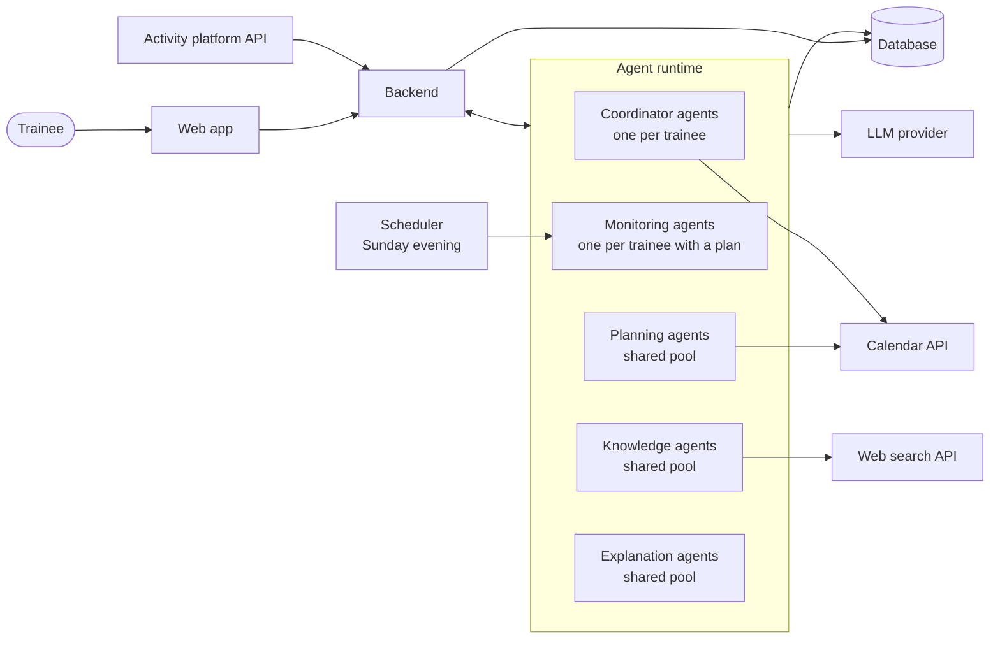

The backend:

- handles accounts and integration consent;
- stores everything in the database;
- turns outside events (a new synced activity, a submitted form) into messages for the right trainee's agents;
- runs the weekly scheduler.

The agents only make decisions and produce content. They never talk to the trainee directly; all of that goes through the web app.

## 3. Requirements

### 3.1 Functional requirements

**Account, profile and goal**

- **FR-1.** The trainee can connect a calendar and an activity platform, and disconnect them at any time. Both connections are optional.
- **FR-2.** During onboarding the trainee enters: discipline, goal, target date, current level, weekly availability and any health limitations.
- **FR-3.** The system checks the profile for missing and contradictory information. It asks follow-up questions instead of assuming values.
- **FR-4.** A trainee has at most one active goal and one active plan at a time.

**Knowledge**

- **FR-5.** The system searches the web for training guidance that fits the trainee's discipline, goal, level and limitations.
- **FR-6.** Every source gets a credibility rating. Sources below a threshold are not used. Every piece of guidance keeps a reference to its source.
- **FR-7.** Research results are reused for the same trainee as long as they still cover the situation. New research happens only when they don't.

**Planning**

- **FR-8.** The system generates a full plan from the start date to the target date. Each workout has a date, type, duration, intensity and short description.
- **FR-9.** A plan never schedules a workout outside the trainee's declared availability. If a calendar is connected, it also never schedules one in a busy calendar slot.
- **FR-10.** The system proposes a plan change after:
  - a reported availability change or missed workout;
  - a significant deviation detected by monitoring;
  - the weekly review;
  - an injury, illness or recovery report.
- **FR-11.** If a change turns out to be unnecessary, the system says so instead of producing an empty proposal.

**Explanations and decisions**

- **FR-12.** Every proposal comes with a plain-language explanation: what changed compared to the current plan, why, and which sources support it.
- **FR-13.** No plan and no change takes effect without the trainee's explicit acceptance. This includes suspending the plan.
- **FR-14.** The trainee can reject a proposal and optionally give a reason. The system then prepares a revised proposal, up to a configurable number of attempts. After that the current plan stays, and the trainee is told so.
- **FR-15.** All plan versions are stored, including rejected proposals. The trainee can browse the history of accepted versions together with their explanations.
- **FR-16.** If a calendar is connected, workouts from the accepted plan are written to it. When the plan changes, the calendar entries are updated or removed.

**Monitoring**

- **FR-17.** Completed activities are imported from the connected activity platform. The trainee can also enter activities manually.
- **FR-18.** After a workout, the trainee can fill in a short voluntary survey: perceived effort, fatigue, pain and notes.
- **FR-19.** New activity data and survey answers are compared with the plan as soon as they arrive. Significant deviations (with configurable thresholds) start an adaptation immediately. Smaller ones wait for the weekly review.
- **FR-20.** Every Sunday evening the system prepares a summary of the past week (planned vs. done). Where needed, it attaches a proposed adjustment for the coming week.
- **FR-21.** The trainee can report an availability change or a missed workout at any time.

**Health**

- **FR-22.** The trainee can report an injury or an illness.
- **FR-23.** Every injury or illness report is checked for red-flag symptoms (for example chest pain, fainting, shortness of breath at rest, sharp or acute pain, a suspected fracture). If one is found, the system proposes suspending the plan and recommends seeing a doctor. While a red flag stands, it proposes no training at all.
- **FR-24.** Without red flags, the system proposes a reduced plan with a clear disclaimer.
- **FR-25.** If the trainee declines a suspension, the current plan stays, a warning is shown and the decision is logged.
- **FR-26.** After a suspension, the trainee can report recovery. The report must include a confirmation of medical clearance. The system then proposes a return-to-training plan.

### 3.2 Non-functional requirements

- **NFR-1. Safety boundaries.** The system is not a medical device, and says so wherever it gives advice about injury or illness. The red-flag list is maintained by the team together with someone qualified to review it. The red-flag check runs on every health report, without exception.
- **NFR-2. Privacy.** Health reports are special-category data under GDPR (art. 9) and need explicit consent. Integrations are opt-in and can be revoked. They request the narrowest scopes available: calendar free/busy, plus write access only to events created by the app. The trainee can export and delete their data.
- **NFR-3. Traceability.** Every plan version stores what triggered it, which sources it used, its explanation and the trainee's decision. It must be possible to answer "why does my plan look like this?" for any past version.
- **NFR-4. Responsiveness.** Preparing a proposal can take a while (web search plus several model calls). The web app shows progress while it happens. Target times are still to be agreed (section 9).
- **NFR-5. Scalability.** Knowledge, planning and explanation agents are stateless and run as pools that scale with load. Per-trainee agents can be suspended when idle and restored from the database.
- **NFR-6. Reliability.** No event from the trainee or an integration is lost. Events for one trainee are queued, and that trainee has at most one process running at a time. After a restart, agents continue from persisted state.
- **NFR-7. Failure handling.** A failure of an external service (web search, calendar, activity platform, LLM provider) never changes the current plan. The running process stops, and the trainee sees what didn't work.
- **NFR-8. Cost control.** The number of model calls per process is bounded by the attempt limit from FR-14. Research is reused as described in FR-7.
- **NFR-9. Platform neutrality.** The design doesn't depend on a specific agent framework. Each protocol in section 4.3 is a request/reply or a one-way notification, so it maps onto any message-based runtime. On a FIPA platform, for example, these become REQUEST/INFORM.
- **NFR-10. Understandability.** Explanations are written for beginners: no unexplained jargon, and each change is tied to a concrete reason.

## 4. Gaia analysis

### 4.1 Information used by the roles

The role permissions below refer to these pieces of information.

| Name | What it is | Where it lives |
|---|---|---|
| `userId` | Identifier of the trainee a role instance works for | Supplied when the agent is created |
| `userInput` | Whatever the trainee submitted in the web app | Web app → backend |
| `profile` | Discipline, goal, target date, level, weekly availability, health limitations | Database |
| `profileGaps`, `clarifyingQuestions` | Missing or contradictory profile fields, and the questions about them | Produced per check |
| `changeReport` | Reported availability change or missed workout | Database |
| `healthReport` | Injury, illness or recovery report (with `kind` and `clearanceConfirmed`) | Database |
| `researchQuery` | Discipline, goal, level, limitations, and what the research should focus on | Produced per request |
| `webContent` | Search results and pages | Web search API |
| `knowledgeBrief` | Guidance with source references and a credibility rating per source | Database |
| `minCredibility` | Credibility threshold | Configuration |
| `calendarAvailability` | Free/busy slots | Calendar API |
| `calendarEvents` | Workout events the app created in the trainee's calendar | Calendar API |
| `activityLog` | Synced and manually entered activities | Database |
| `surveyResponses` | Post-workout surveys | Database |
| `currentPlan` | Latest accepted plan version (`status`: active or suspended) | Database |
| `planHistory` | All plan versions, including rejected proposals | Database |
| `trigger` | What started the current process: `changeReport`, `deviation`, `weeklySummary` or `healthReport` | Produced per process |
| `proposal` | Proposed plan version; `NULL` when no change is needed. `type`: new, modification, reduced, suspension, returnToTraining | Database |
| `redFlag` | Whether a health report contains red-flag symptoms | Produced by `PLANNER` |
| `redFlagCriteria` | The red-flag symptom list | Configuration |
| `explanation` | Plain-language explanation of a proposal | Database |
| `userDecision`, `rejectionReason` | Accepted/rejected, and the optional reason | Database |
| `attempts`, `maxAttempts` | Proposals made in the current process, and the limit | Process state / configuration |
| `deviation` | A significant difference between plan and execution | Produced by `PROGRESSMONITOR` |
| `deviationThresholds` | When a difference counts as significant | Configuration |
| `weeklySummary` | Planned vs. done for the past week | Database |
| `message` | Informational text for the trainee (no change needed, plan kept, warning, confirmation) | Produced per process |

### 4.2 Roles model

There are seven roles. The trainee is not a role and reaches the system only through the web app.

| Role                  | One-line description                                          |
| --------------------- | ------------------------------------------------------------- |
| `USERHANDLER`         | The system's contact point with the trainee                   |
| `WORKFLOWMANAGER`     | Runs each process for one trainee from start to finish        |
| `PROFILEMANAGER`      | Decides whether the profile is good enough to plan with       |
| `KNOWLEDGERESEARCHER` | Finds and rates training guidance on the web                  |
| `PLANNER`             | Creates and modifies plans, including the health-related ones |
| `EXPLAINER`           | Explains proposals in plain language                          |
| `PROGRESSMONITOR`     | Compares the plan with what the trainee actually did          |

#### Role schema: USERHANDLER

| | |
|---|---|
| **Description** | Picks up everything the trainee submits in the web app: the onboarding form, change reports, health reports, answers and decisions. Hands requests over to the workflow manager and shows the trainee questions, proposals and messages. |
| **Protocols** | `SubmitRequest`, `AskUser`, `ReturnAnswers`, `PresentProposal`, `ReturnDecision`, `InformUser` |
| **Activities** | `AwaitUserInput`, `ShowToUser` |
| **Permissions** | **reads supplied** `userId` **reads** `userInput`, `clarifyingQuestions`, `proposal`, `explanation`, `message` **generates** `profile` (onboarding form), `changeReport`, `healthReport`, `userDecision`, `rejectionReason` **changes** `profile` (answers to follow-up questions) |
| **Liveness** | `USERHANDLER = (AwaitUserInput . SubmitRequest)ω \|\| (ServeWorkflow)ω` `SERVEWORKFLOW = Clarify \| Decide \| Inform` `CLARIFY = AskUser . ShowToUser . AwaitUserInput . ReturnAnswers` `DECIDE = PresentProposal . ShowToUser . AwaitUserInput . ReturnDecision` `INFORM = InformUser . ShowToUser` |
| **Safety** | `userDecision ≠ NULL ⇒ author(userDecision) = trainee` `healthReport.kind = recovery ⇒ healthReport.clearanceConfirmed = true` |

The first safety condition says the role never decides on the trainee's behalf. The second means the web app doesn't accept a recovery report unless medical clearance is confirmed.

#### Role schema: WORKFLOWMANAGER

|                 |                                                                                                                                                                                                                                                                                                                                                                                                                                                                                                                                                                                                                                                                     |
| --------------- | ------------------------------------------------------------------------------------------------------------------------------------------------------------------------------------------------------------------------------------------------------------------------------------------------------------------------------------------------------------------------------------------------------------------------------------------------------------------------------------------------------------------------------------------------------------------------------------------------------------------------------------------------------------------- |
| **Description** | Runs the processes for one trainee: onboarding, adaptation after a change, deviation or health report, and the weekly review. Decides which role is asked next, counts proposals within a process, and saves a plan only after the trainee accepts it.                                                                                                                                                                                                                                                                                                                                                                                                              |
| **Protocols**   | `SubmitRequest`, `ReportDeviation`, `WeeklyReview`, `ProfileCheckRequest`, `ProfileVerdict`, `AskUser`, `ReturnAnswers`, `KnowledgeRequest`, `KnowledgeReply`, `PlanRequest`, `PlanReply`, `ExplanationRequest`, `ExplanationReply`, `PresentProposal`, `ReturnDecision`, `InformUser`, `PlanUpdated`                                                                                                                                                                                                                                                                                                                                                               |
| **Activities**  | `CommitPlan`, `SyncCalendar`                                                                                                                                                                                                                                                                                                                                                                                                                                                                                                                                                                                                                                        |
| **Permissions** | **reads supplied** `userId` **reads** `profile`, `changeReport`, `healthReport`, `deviation`, `weeklySummary`, `knowledgeBrief`, `proposal`, `explanation`, `userDecision`, `rejectionReason`, `maxAttempts` **generates** `researchQuery`, `trigger`, `message` **changes** `currentPlan`, `planHistory`, `calendarEvents`, `attempts`                                                                                                                                                                                                                                                                                                                 |
| **Liveness**    | `WORKFLOWMANAGER = (Onboarding \| Adaptation \| WeeklyProcess)ω` `ONBOARDING = SubmitRequest . CompleteProfile . ObtainKnowledge . Negotiate` `COMPLETEPROFILE = (ProfileCheckRequest . ProfileVerdict . [AskUser . ReturnAnswers])+` `OBTAINKNOWLEDGE = KnowledgeRequest . KnowledgeReply` `ADAPTATION = (SubmitRequest \| ReportDeviation) . [ObtainKnowledge] . Negotiate` `WEEKLYPROCESS = WeeklyReview . Negotiate` `NEGOTIATE = (PlanRequest . PlanReply . [ExplanationRequest . ExplanationReply . PresentProposal . ReturnDecision])+ . (Commit \| InformUser)` `COMMIT = CommitPlan . SyncCalendar . PlanUpdated . InformUser` |
| **Safety**      | `activeProcesses(userId) ≤ 1` `attempts ≤ maxAttempts` `currentPlan changed ⇒ userDecision = accepted` `shown(proposal) ⇒ explanation ≠ NULL` `calendarEvents = workouts(currentPlan)`                                                                                                                                                                                                                                                                                                                                                                                                                                                              |

`ADAPTATION` covers change reports, health reports and recovery reports, which all arrive through `SubmitRequest`, as well as deviations from monitoring. They differ in the data they carry, not in the shape of the interaction. The `NEGOTIATE` loop ends in one of four ways:

- the planner says no change is needed;
- the trainee accepts;
- the attempt limit is reached;
- the trainee declines a suspension.

#### Role schema: PROFILEMANAGER

| | |
|---|---|
| **Description** | Checks whether the profile is complete and consistent enough to plan with, and writes follow-up questions about whatever is missing or contradictory. |
| **Protocols** | `ProfileCheckRequest`, `ProfileVerdict` |
| **Activities** | `AssessProfile`, `DraftQuestions` |
| **Permissions** | **reads supplied** `profile` **generates** `profileGaps`, `clarifyingQuestions` |
| **Liveness** | `PROFILEMANAGER = (ProfileCheckRequest . AssessProfile . [DraftQuestions] . ProfileVerdict)ω` |
| **Safety** | `profileGaps = ∅ ⇔ clarifyingQuestions = ∅` |

The role can only read the profile. It cannot fill a gap with an assumed value.

#### Role schema: KNOWLEDGERESEARCHER

| | |
|---|---|
| **Description** | Searches the web for training guidance that fits the query, rates each source's credibility, drops the weak ones and returns a brief with references. |
| **Protocols** | `KnowledgeRequest`, `KnowledgeReply` |
| **Activities** | `SearchWeb`, `RateSources`, `CompileBrief` |
| **Permissions** | **reads supplied** `researchQuery` **reads** `webContent`, `minCredibility` **generates** `knowledgeBrief` |
| **Liveness** | `KNOWLEDGERESEARCHER = (KnowledgeRequest . SearchWeb+ . RateSources . CompileBrief . KnowledgeReply)ω` |
| **Safety** | `∀ s ∈ sources(knowledgeBrief): credibility(s) ≥ minCredibility` `∀ c ∈ claims(knowledgeBrief): sources(c) ≠ ∅` |

#### Role schema: PLANNER

| | |
|---|---|
| **Description** | Builds the full plan up to the target date and modifies it when something changes. Checks the hard constraints itself: declared availability and, if a calendar is connected, busy slots. It never returns a plan that breaks them. For health reports it first checks for red flags, then proposes either a suspension or a reduced plan. After a recovery report it proposes a return-to-training plan. |
| **Protocols** | `PlanRequest`, `PlanReply` |
| **Activities** | `AssessImpact`, `ScreenForRedFlags`, `PrepareSuspension`, `DraftPlan`, `CheckConstraints` |
| **Permissions** | **reads supplied** `profile`, `trigger`, `rejectionReason` **reads** `currentPlan`, `knowledgeBrief`, `calendarAvailability`, `activityLog`, `redFlagCriteria` **generates** `proposal`, `redFlag` |
| **Liveness** | `PLANNER = (PlanRequest . Planning . PlanReply)ω` `PLANNING = HealthPlanning \| ChangePlanning` `HEALTHPLANNING = ScreenForRedFlags . (PrepareSuspension \| (DraftPlan . CheckConstraints)+)` `CHANGEPLANNING = [AssessImpact] . [(DraftPlan . CheckConstraints)+]` |
| **Safety** | `proposal ≠ NULL ∧ proposal.type ≠ suspension ⇒ fits(proposal, profile.availability) ∧ fits(proposal, calendarAvailability)` `proposal.type ∈ {new, modification, reduced, returnToTraining} ⇒ proposal.end = profile.targetDate` `redFlag = true ⇒ proposal.type = suspension` `healthReport.kind ∈ {injury, illness} ∧ redFlag = false ⇒ proposal.type = reduced ∧ proposal.disclaimer ≠ NULL` `proposal.type = returnToTraining ⇒ healthReport.clearanceConfirmed = true` |

`AssessImpact` is skipped during onboarding, because there is no current plan yet. If it decides no change is needed, drafting is skipped and the reply carries `proposal = NULL`. The constraint check is code, not a model call. A draft that fails it goes back to `DraftPlan`.

#### Role schema: EXPLAINER

| | |
|---|---|
| **Description** | Writes a plain-language explanation of a proposal: what changed compared to the current plan, why, and which sources support it. Includes the disclaimer for reduced plans, and the recommendation to see a doctor for suspensions. |
| **Protocols** | `ExplanationRequest`, `ExplanationReply` |
| **Activities** | `CompareVersions`, `WriteExplanation` |
| **Permissions** | **reads supplied** `proposal`, `trigger` **reads** `currentPlan`, `knowledgeBrief` **generates** `explanation` |
| **Liveness** | `EXPLAINER = (ExplanationRequest . [CompareVersions] . WriteExplanation . ExplanationReply)ω` |
| **Safety** | `∀ ch ∈ diff(currentPlan, proposal): covers(explanation, ch)` `sources(explanation) ⊆ sources(knowledgeBrief)` `proposal.type = suspension ⇒ recommendsDoctor(explanation)` `proposal.disclaimer ≠ NULL ⇒ contains(explanation, proposal.disclaimer)` |

The second safety condition means the explainer can't cite a source that the knowledge researcher didn't provide.

#### Role schema: PROGRESSMONITOR

| | |
|---|---|
| **Description** | Watches one trainee's accepted plan. Compares it with synced activities and survey answers as they arrive, and reports significant deviations straight away. Every Sunday evening it sends a summary of planned vs. done. |
| **Protocols** | `PlanUpdated`, `ReportDeviation`, `WeeklyReview` |
| **Activities** | `AwaitActivityData`, `CompareWithPlan`, `CompileWeeklySummary` |
| **Permissions** | **reads supplied** `currentPlan` **reads** `activityLog`, `surveyResponses`, `deviationThresholds` **generates** `deviation`, `weeklySummary` |
| **Liveness** | `PROGRESSMONITOR = PlanUpdated . ((PlanUpdated)ω \|\| (Observe)ω \|\| (Summarise)ω)` `OBSERVE = AwaitActivityData . CompareWithPlan . [ReportDeviation]` `SUMMARISE = CompileWeeklySummary . WeeklyReview` |
| **Safety** | `deviation ≠ NULL ⇒ exceeds(deviation, deviationThresholds)` `currentPlan.status ≠ active ⇒ deviation = NULL ∧ weeklySummary = NULL` |

`SUMMARISE` is triggered by time (Sunday evening), not by another role. While the plan is suspended, the monitor keeps receiving data but reports nothing.

### 4.3 Interaction model

| Protocol | Purpose | Initiator | Responder | Inputs | Outputs | Processing |
|---|---|---|---|---|---|---|
| `SubmitRequest` | Hand over a new request from the trainee | `USERHANDLER` | `WORKFLOWMANAGER` | request type; `profile`, `changeReport` or `healthReport` | – | Workflow manager starts the matching process, or queues it if one is already running |
| `AskUser` | Ask follow-up questions | `WORKFLOWMANAGER` | `USERHANDLER` | `clarifyingQuestions` | – | User handler shows the questions and waits |
| `ReturnAnswers` | Pass the answers back | `USERHANDLER` | `WORKFLOWMANAGER` | answers | updated `profile` | Answers are written into the profile, which is then checked again |
| `ProfileCheckRequest` | Ask whether the profile is usable | `WORKFLOWMANAGER` | `PROFILEMANAGER` | `profile` | – | Profile manager assesses the profile |
| `ProfileVerdict` | Return the result of the check | `PROFILEMANAGER` | `WORKFLOWMANAGER` | `profileGaps`, `clarifyingQuestions` | – | Empty lists mean the profile is complete |
| `KnowledgeRequest` | Ask for training guidance | `WORKFLOWMANAGER` | `KNOWLEDGERESEARCHER` | `researchQuery` | – | Researcher searches, rates and compiles |
| `KnowledgeReply` | Return the guidance | `KNOWLEDGERESEARCHER` | `WORKFLOWMANAGER` | `knowledgeBrief` | – | Brief is stored for later reuse |
| `PlanRequest` | Ask for a new plan or a change | `WORKFLOWMANAGER` | `PLANNER` | `profile`, `trigger`, `currentPlan`, `knowledgeBrief`, `rejectionReason` | – | Planner screens, assesses, drafts and checks |
| `PlanReply` | Return the result | `PLANNER` | `WORKFLOWMANAGER` | `proposal` (or `NULL`), `redFlag` | – | `NULL` means no change is needed |
| `ExplanationRequest` | Ask for an explanation of a proposal | `WORKFLOWMANAGER` | `EXPLAINER` | `proposal`, `currentPlan`, `trigger`, `knowledgeBrief` | – | Explainer compares versions and writes the text |
| `ExplanationReply` | Return the explanation | `EXPLAINER` | `WORKFLOWMANAGER` | `explanation` | – | – |
| `PresentProposal` | Show a proposal to the trainee | `WORKFLOWMANAGER` | `USERHANDLER` | `proposal`, `explanation`, optionally `weeklySummary` | – | User handler shows it and waits for a decision |
| `ReturnDecision` | Pass the trainee's decision back | `USERHANDLER` | `WORKFLOWMANAGER` | `userDecision`, `rejectionReason` | – | Workflow manager commits, retries or stops |
| `InformUser` | Tell the trainee something that needs no decision | `WORKFLOWMANAGER` | `USERHANDLER` | `message` | – | Shown in the web app |
| `PlanUpdated` | Tell the monitor which plan version to track | `WORKFLOWMANAGER` | `PROGRESSMONITOR` | `currentPlan` | – | Monitor replaces the tracked version; a suspended plan stops reporting |
| `ReportDeviation` | Report a significant deviation | `PROGRESSMONITOR` | `WORKFLOWMANAGER` | `deviation` | – | Starts an adaptation (process 2) |
| `WeeklyReview` | Deliver the weekly summary | `PROGRESSMONITOR` | `WORKFLOWMANAGER` | `weeklySummary` | – | Starts the weekly review (process 3) |
## 5. Gaia design

### 5.1 Agent model

Roles are grouped into five agent types. The three coordinator roles share one agent: they work on the same trainee's state and talk to each other constantly, so splitting them across agents would only add messages. Each specialist role gets its own agent type so it can be scaled on its own.

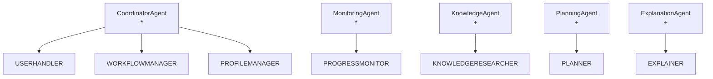

| Agent type         | Roles                                              | Instances                                  | Why                                                                                        |
| ------------------ | -------------------------------------------------- | ------------------------------------------ | ------------------------------------------------------------------------------------------ |
| `CoordinatorAgent` | `USERHANDLER`, `WORKFLOWMANAGER`, `PROFILEMANAGER` | `*`: one per registered trainee            | Holds the trainee's process state and serialises their events. Can be suspended when idle. |
| `MonitoringAgent`  | `PROGRESSMONITOR`                                  | `*`: one per trainee with an accepted plan | Watches one trainee's data and owns their weekly timer                                     |
| `KnowledgeAgent`   | `KNOWLEDGERESEARCHER`                              | `+`: shared pool                           | Stateless; scaled with load                                                                |
| `PlanningAgent`    | `PLANNER`                                          | `+`: shared pool                           | Stateless; scaled with load                                                                |
| `ExplanationAgent` | `EXPLAINER`                                        | `+`: shared pool                           | Stateless; scaled with load                                                                |

This hybrid was chosen over two alternatives:

- **Fully shared agents:** one coordinator would become a bottleneck and a single point of failure, and per-trainee state would have to be loaded on every message.
- **A full set of agents per trainee:** the number of mostly idle agents would grow with the number of trainees, and research results wouldn't be reused.

The cost of the hybrid is two agent lifecycles to manage. Every request to a shared specialist must also carry all the context it needs.

### 5.2 Services model

**CoordinatorAgent**

| Service               | Inputs                                                | Outputs                                                      | Pre-condition                          | Post-condition                                                                                                                |
| --------------------- | ----------------------------------------------------- | ------------------------------------------------------------ | -------------------------------------- | ----------------------------------------------------------------------------------------------------------------------------- |
| capture trainee input | `userInput`                                           | `profile` / `changeReport` / `healthReport` / `userDecision` | true                                   | request handed to the workflow manager                                                                                        |
| check profile         | `profile`                                             | `profileGaps`, `clarifyingQuestions`                         | `profile ≠ NULL`                       | `profileGaps = ∅ ⇔ clarifyingQuestions = ∅`                                                                                   |
| complete profile      | `profile`, answers                                    | `profile`                                                    | `profileGaps ≠ ∅`                      | `profileGaps = ∅`                                                                                                             |
| obtain knowledge      | `researchQuery`                                       | `knowledgeBrief`                                             | `profileGaps = ∅`                      | `knowledgeBrief ≠ NULL`                                                                                                       |
| negotiate proposal    | `profile`, `trigger`, `currentPlan`, `knowledgeBrief` | `userDecision`, `attempts`                                   | `knowledgeBrief ≠ NULL ∧ attempts = 0` | `proposal = NULL ∨ userDecision = accepted ∨ attempts = maxAttempts ∨ (proposal.type = suspension ∧ userDecision = rejected)` |
| commit plan           | `proposal`, `userDecision`                            | `currentPlan`, `planHistory`, `calendarEvents`               | `userDecision = accepted`              | `currentPlan = proposal ∧ calendarEvents = workouts(currentPlan)`                                                             |
| inform trainee        | `message`                                             | –                                                            | true                                   | trainee has seen `message`                                                                                                    |

**KnowledgeAgent**

| Service | Inputs | Outputs | Pre-condition | Post-condition |
|---|---|---|---|---|
| research training guidance | `researchQuery` | `knowledgeBrief` | `researchQuery ≠ NULL` | `∀ s ∈ sources(knowledgeBrief): credibility(s) ≥ minCredibility` |

**PlanningAgent**

| Service | Inputs | Outputs | Pre-condition | Post-condition |
|---|---|---|---|---|
| screen health report | `healthReport`, `redFlagCriteria` | `redFlag` | `trigger = healthReport` | `redFlag ≠ NULL` |
| prepare suspension | `currentPlan` | `proposal` | `redFlag = true` | `proposal.type = suspension` |
| assess impact | `trigger`, `currentPlan`, `activityLog` | change needed (yes/no) | `currentPlan ≠ NULL` | decision made |
| produce plan proposal | `profile`, `trigger`, `currentPlan`, `knowledgeBrief`, `calendarAvailability`, `rejectionReason` | `proposal` | `redFlag ≠ true` | `fits(proposal, profile.availability) ∧ fits(proposal, calendarAvailability) ∧ proposal.end = profile.targetDate` |

**ExplanationAgent**

| Service | Inputs | Outputs | Pre-condition | Post-condition |
|---|---|---|---|---|
| explain proposal | `proposal`, `currentPlan`, `trigger`, `knowledgeBrief` | `explanation` | `proposal ≠ NULL` | `∀ ch ∈ diff(currentPlan, proposal): covers(explanation, ch) ∧ sources(explanation) ⊆ sources(knowledgeBrief)` |

**MonitoringAgent**

| Service | Inputs | Outputs | Pre-condition | Post-condition |
|---|---|---|---|---|
| track plan | `currentPlan` | – | `userDecision = accepted` | monitor tracks the latest accepted version |
| detect deviation | `activityLog`, `surveyResponses`, `currentPlan`, `deviationThresholds` | `deviation` | `currentPlan.status = active` | `deviation = NULL ∨ exceeds(deviation, deviationThresholds)` |
| weekly review | `activityLog`, `surveyResponses`, `currentPlan` | `weeklySummary` | `currentPlan.status = active` ∧ Sunday evening | `weeklySummary ≠ NULL` |

### 5.3 Acquaintance model

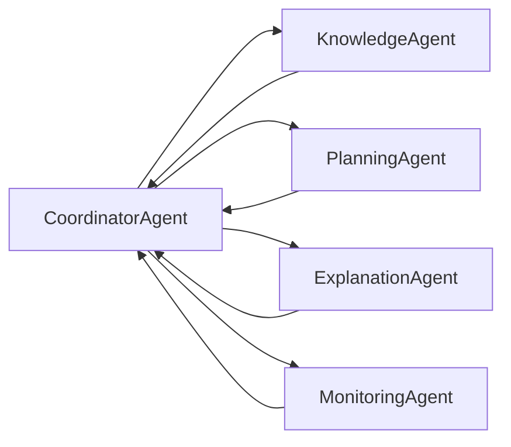

The specialists never talk to each other, only to the coordinator. Because there is one coordinator per trainee, the hub isn't shared between trainees. The shared resources are the stateless specialist pools.

## 6. Processes (BPMN 2.0)

The Mermaid diagrams are approximations. The authoritative collaboration diagrams are the `.bpmn` files in [`bpmn/`](bpmn/), each with an SVG rendering next to it.

### 6.1 Conversation diagram

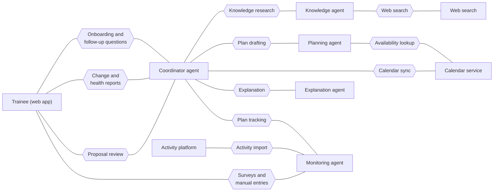

"Plan tracking" groups three protocols: `PlanUpdated`, `ReportDeviation` and `WeeklyReview`. "Proposal review" groups `PresentProposal`/`ReturnDecision` together with the informational messages.

### 6.2 Process 1: Onboarding and initial plan

The trainee fills in the onboarding form. The profile manager checks it, and the trainee answers follow-up questions until nothing is missing. The knowledge agent researches the discipline and goal, and the planner drafts the full plan, reading the calendar and checking hard constraints. The explainer writes the explanation. If the trainee rejects the proposal, the planner tries again with the trainee's reason, up to the attempt limit. If they accept, the plan is saved, written to the calendar and handed to a new monitoring agent.

**Choreography**

```mermaid
flowchart LR
    s((start)) --> t1["Trainee<br/><b>Submit onboarding form</b><br/>Coordinator"]
    t1 --> g1{"Profile<br/>complete?"}
    g1 -- no --> t2["Coordinator<br/><b>Ask follow-up questions</b><br/>(reply: answers)<br/>Trainee"]
    t2 --> g1
    g1 -- yes --> t3["Coordinator<br/><b>Request knowledge</b><br/>Knowledge agent"]
    t3 --> t4["Knowledge agent<br/><b>Search</b><br/>(reply: results)<br/>Web search"]
    t4 --> t5["Knowledge agent<br/><b>Return brief</b><br/>Coordinator"]
    t5 --> m1{" "}
    m1 --> t6["Coordinator<br/><b>Request plan</b><br/>Planning agent"]
    t6 --> t7["Planning agent<br/><b>Query free/busy</b><br/>(reply: free/busy)<br/>Calendar"]
    t7 --> t8["Planning agent<br/><b>Return proposal</b><br/>Coordinator"]
    t8 --> t9["Coordinator<br/><b>Explain proposal</b><br/>(reply: explanation)<br/>Explanation agent"]
    t9 --> t10["Coordinator<br/><b>Present proposal</b><br/>(reply: decision)<br/>Trainee"]
    t10 --> g2{"Accepted?"}
    g2 -- yes --> t11["Coordinator<br/><b>Write workouts</b><br/>Calendar"]
    t11 --> t12["Coordinator<br/><b>Plan updated</b><br/>Monitoring agent"]
    t12 --> t13["Coordinator<br/><b>Confirm plan</b><br/>Trainee"]
    t13 --> e1(((end)))
    g2 -- no --> g3{"Attempts<br/>left?"}
    g3 -- yes --> m1
    g3 -- no --> t14["Coordinator<br/><b>No plan saved</b><br/>Trainee"]
    t14 --> e2(((end)))
```

**Collaboration.** BPMN file: [`bpmn/1-onboarding.bpmn`](bpmn/1-onboarding.bpmn).

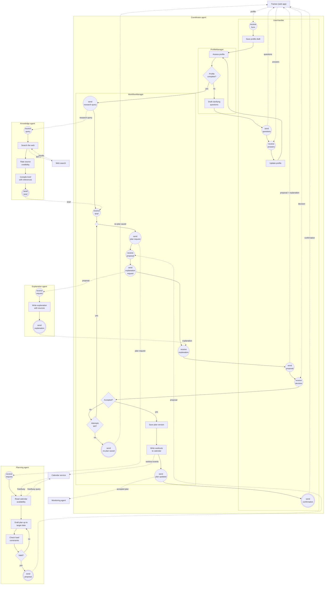

BPMN rendering (SVG)

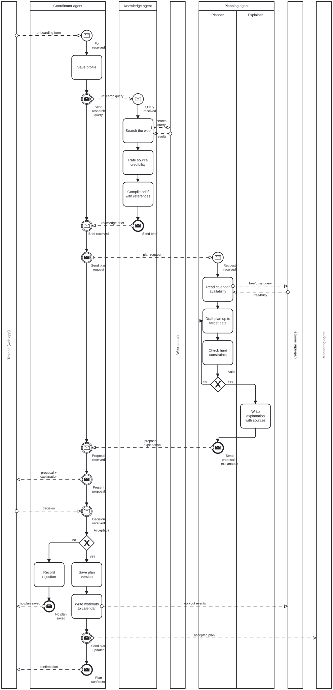

### 6.3 Process 2: Plan adaptation after a change

There are two triggers:

- the trainee reports an availability change or a missed workout;
- the monitoring agent reports a significant deviation.

If the stored knowledge brief doesn't cover the new situation, the coordinator asks for more research first. The planner then assesses the impact on the plan. If no change is needed, the trainee is simply told so. Otherwise the planner drafts a modification, which goes through the same explain, present, decide and retry loop as in process 1. Here the knowledge and explanation agents are shown as black boxes; their insides are the same as in process 1.

**Choreography**

```mermaid
flowchart LR
    s((start)) --> g0{"Trigger"}
    g0 --> t1["Trainee<br/><b>Report change</b><br/>Coordinator"]
    g0 --> t2["Monitoring agent<br/><b>Report deviation</b><br/>Coordinator"]
    t1 --> m0{" "}
    t2 --> m0
    m0 --> g1{"Brief covers<br/>the change?"}
    g1 -- no --> t3["Coordinator<br/><b>Request knowledge</b><br/>(reply: brief)<br/>Knowledge agent"]
    t3 --> m1{" "}
    g1 -- yes --> m1
    m1 --> m2{" "}
    m2 --> t4["Coordinator<br/><b>Request plan change</b><br/>Planning agent"]
    t4 --> g2{"Change<br/>needed?"}
    g2 -- yes --> t5["Planning agent<br/><b>Query free/busy</b><br/>(reply: free/busy)<br/>Calendar"]
    t5 --> m3{" "}
    g2 -- no --> m3
    m3 --> t6["Planning agent<br/><b>Return reply</b><br/>Coordinator"]
    t6 --> g3{"Proposal?"}
    g3 -- no --> t7["Coordinator<br/><b>No change needed</b><br/>Trainee"]
    t7 --> e1(((end)))
    g3 -- yes --> t8["Coordinator<br/><b>Explain proposal</b><br/>(reply: explanation)<br/>Explanation agent"]
    t8 --> t9["Coordinator<br/><b>Present proposal</b><br/>(reply: decision)<br/>Trainee"]
    t9 --> g4{"Accepted?"}
    g4 -- yes --> t10["Coordinator<br/><b>Update calendar</b><br/>Calendar"]
    t10 --> t11["Coordinator<br/><b>Plan updated</b><br/>Monitoring agent"]
    t11 --> t12["Coordinator<br/><b>Confirm change</b><br/>Trainee"]
    t12 --> e2(((end)))
    g4 -- no --> g5{"Attempts<br/>left?"}
    g5 -- yes --> m2
    g5 -- no --> t13["Coordinator<br/><b>Plan kept</b><br/>Trainee"]
    t13 --> e3(((end)))
```

**Collaboration.** BPMN file: [`bpmn/2-adaptation.bpmn`](bpmn/2-adaptation.bpmn).

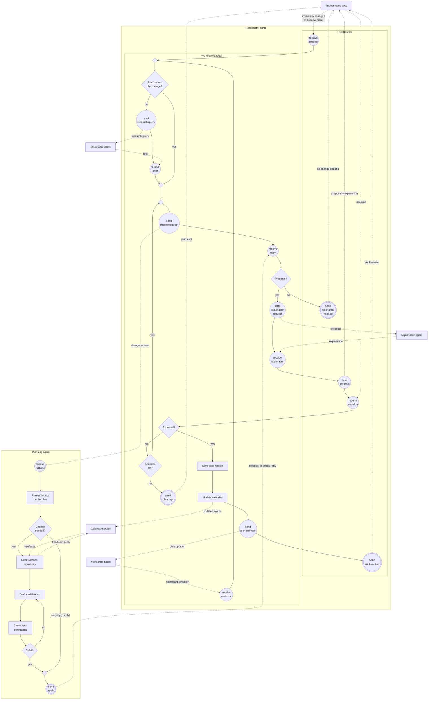

BPMN rendering (SVG)

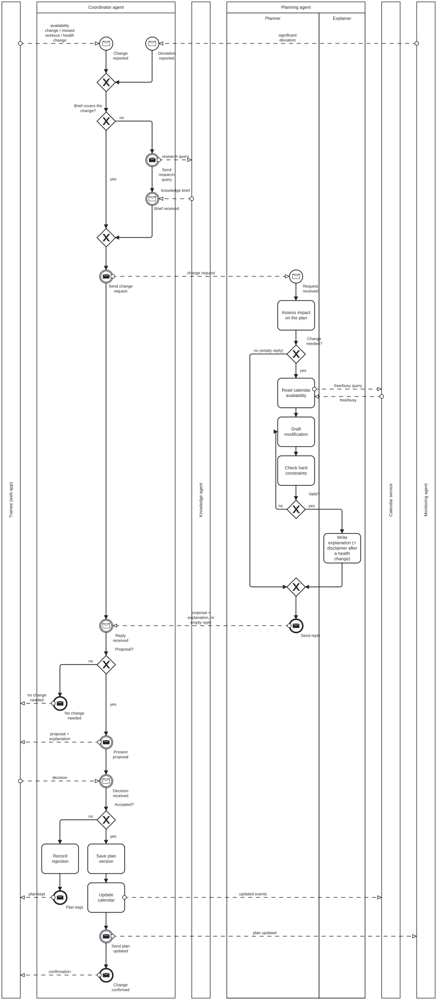

### 6.4 Process 3: Progress monitoring and weekly review

The monitoring agent starts when a plan is first accepted, and then waits for one of four events:

- **A plan update:** it loads the new version.
- **A synced activity, survey answer or manual entry:** it compares the data with the plan. If the deviation is significant, it reports it to the coordinator, which starts process 2.
- **Sunday evening:** if the plan is active, it compiles the weekly summary and sends it to the coordinator.

The coordinator asks the planner for adjustments to the coming week. If there are none, the trainee only sees the summary. Otherwise the summary and the proposal are shown together, with the usual accept or retry loop. Planning and explanation are black boxes here.

**Choreography**

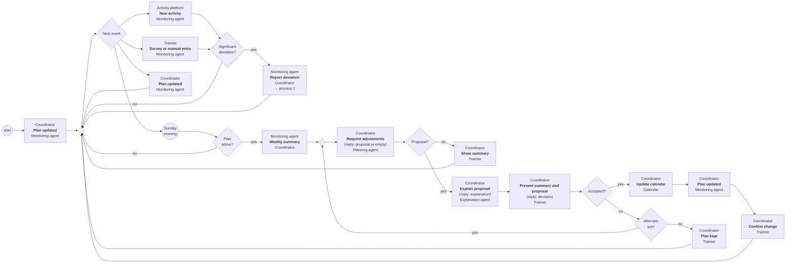

**Collaboration.** BPMN file: [`bpmn/3-monitoring.bpmn`](bpmn/3-monitoring.bpmn).

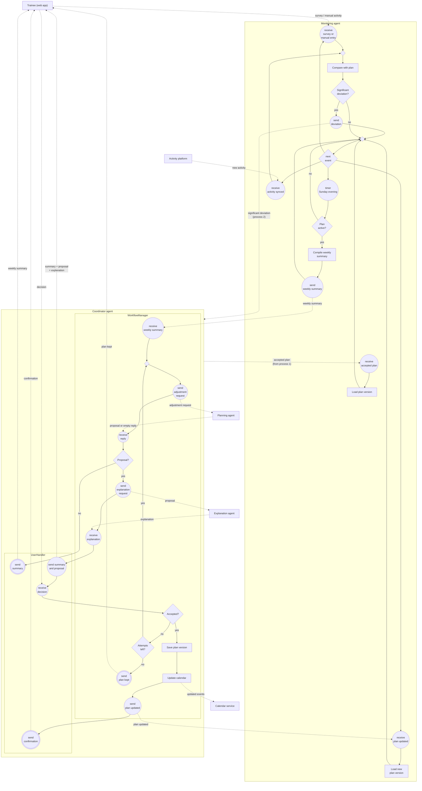

BPMN rendering (SVG)

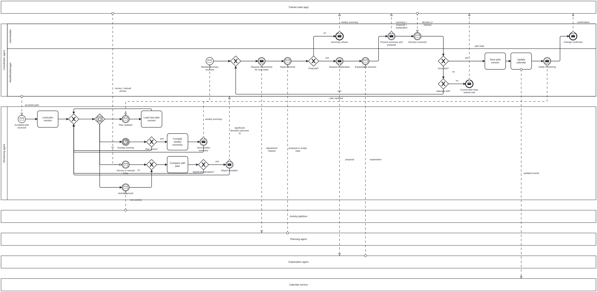

### 6.5 Process 4: Injury, illness and recovery reports

The trainee reports an injury, an illness or a recovery. A recovery report can only be submitted with a confirmation of medical clearance. The planner checks every report for red flags:

- **A red flag:** the only possible proposal is a suspension.
- **An injury or illness without red flags:** a reduced plan with a disclaimer.
- **A recovery report:** a return-to-training plan.

Both plans are checked against hard constraints like any other draft.

The trainee still has to accept the proposal, suspension included. If they decline a suspension, the planner won't offer anything else. The decision is logged, the current plan stays and the trainee gets a warning. A declined reduced plan or return-to-training plan goes through the normal retry loop.

**Choreography**

```mermaid
flowchart LR
    s((start)) --> t1["Trainee<br/><b>Report injury, illness<br/>or recovery</b><br/>Coordinator"]
    t1 --> g1{"Brief<br/>covers it?"}
    g1 -- no --> t2["Coordinator<br/><b>Request knowledge</b><br/>(reply: brief)<br/>Knowledge agent"]
    t2 --> m1{" "}
    g1 -- yes --> m1
    m1 --> m2{" "}
    m2 --> t3["Coordinator<br/><b>Request plan change</b><br/>Planning agent"]
    t3 --> g2{"Red flag?"}
    g2 -- no --> t4["Planning agent<br/><b>Query free/busy</b><br/>(reply: free/busy)<br/>Calendar"]
    t4 --> m3{" "}
    g2 -- yes --> m3
    m3 --> t5["Planning agent<br/><b>Return proposal</b><br/>Coordinator"]
    t5 --> t6["Coordinator<br/><b>Explain proposal</b><br/>(reply: explanation)<br/>Explanation agent"]
    t6 --> t7["Coordinator<br/><b>Present proposal</b><br/>(reply: decision)<br/>Trainee"]
    t7 --> g3{"Accepted?"}
    g3 -- yes --> t8["Coordinator<br/><b>Update calendar</b><br/>Calendar"]
    t8 --> t9["Coordinator<br/><b>Plan updated</b><br/>Monitoring agent"]
    t9 --> t10["Coordinator<br/><b>Confirm change</b><br/>Trainee"]
    t10 --> e1(((end)))
    g3 -- no --> g4{"Suspension<br/>proposal?"}
    g4 -- yes --> t11["Coordinator<br/><b>Warning, plan kept</b><br/>Trainee"]
    t11 --> e2(((end)))
    g4 -- no --> g5{"Attempts<br/>left?"}
    g5 -- yes --> m2
    g5 -- no --> t12["Coordinator<br/><b>Plan kept</b><br/>Trainee"]
    t12 --> e3(((end)))
```

**Collaboration.** BPMN file: [`bpmn/4-health.bpmn`](bpmn/4-health.bpmn).

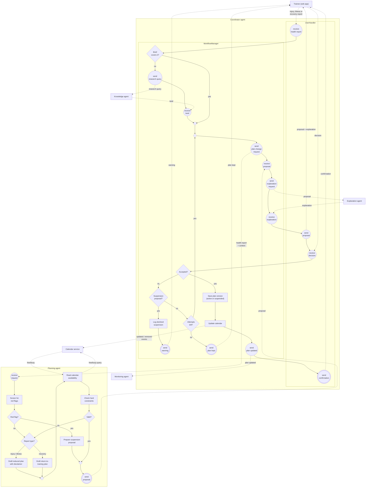

BPMN rendering (SVG)

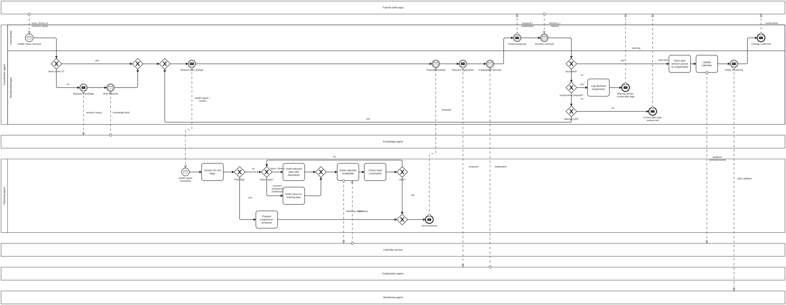

## 7. Data model

Proposals are stored as plan versions with status `proposed`. Accepting one turns it into `accepted` and the previous version into `superseded`. Rejecting it sets `rejected`. This keeps a full record of what was proposed and decided (NFR-3), including declined suspensions (FR-25).

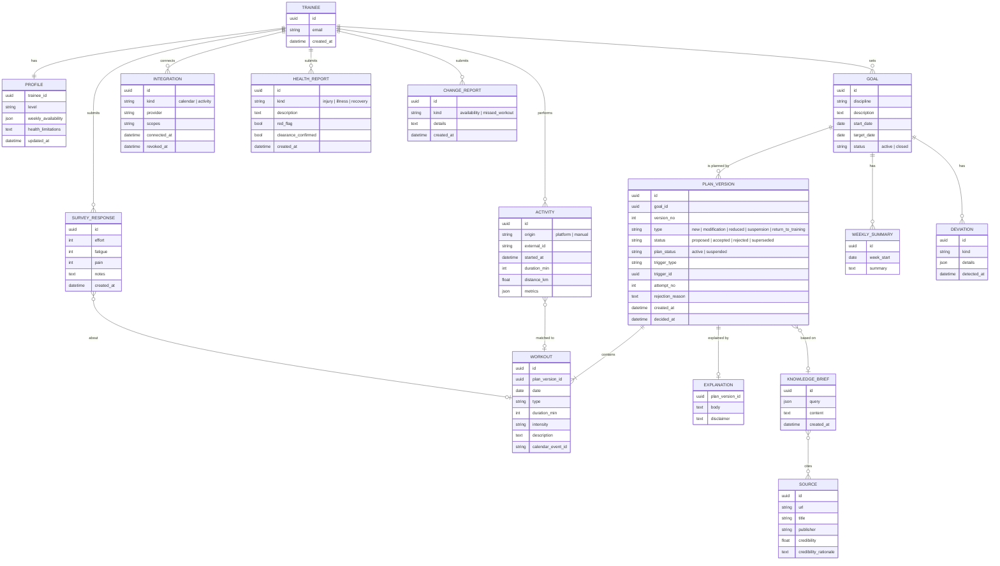

## 8. Risks and limitations

- **Plan quality.** The planner and the knowledge researcher are model-based. A plan can satisfy every hard constraint and still be poor training. Nothing in this design measures training quality; that needs a review by someone qualified, as noted in Raport A.
- **No independent plan review.** Hard constraints are checked inside the planner, and there is no separate reviewer. This is simpler, but the only defence against a bad plan is the planner's own check plus the trainee's decision. The check should be deterministic code, not another model call. Otherwise it isn't really a check.
- **Source credibility is rated by a model.** The ratings are a filter, not a guarantee. A confident, well-written but wrong page can still get through.
- **Red-flag detection on free text.** Symptoms are described by the trainee in their own words, and a model can miss one. The list of red flags and the screening prompt need to be reviewed by someone qualified, and tested on realistic examples. Each health report form should also show a fixed notice to seek medical help for serious symptoms, whatever the system decides.
- **A trainee can decline a suspension.** By design (FR-13), even a red-flag suspension needs acceptance. The system can only warn and log. This is a deliberate trade-off that should be stated clearly in the terms of use.
- **A full plan up front goes stale.** Generating the whole plan to the target date means later weeks are planned on assumptions that will change. Expect frequent modifications, and therefore model costs, especially for long goals.
- **Sparse feedback.** Surveys are voluntary, so for trainees without a connected activity platform, monitoring may have very little to work with. Weekly reviews will then rely mostly on missed workouts.
- **Many disciplines.** A discipline-agnostic system will be uneven: better for popular sports with plenty of good material online, worse for niche ones.
- **Integration limits.** Calendar and activity platform APIs have rate limits, permission models and outages outside our control. NFR-7 limits the damage, but some processes will fail for reasons the trainee can't fix.
- **Two agent lifecycles.** Per-trainee coordinator and monitoring agents have to be created, suspended, restored and removed correctly. Getting that wrong leads to lost events or duplicate processing.

## 9. Open questions

- **Attempt limit** (`maxAttempts`): how many revised proposals before the current plan is kept?
- **Deviation thresholds:** what counts as a significant deviation? Examples: number of missed workouts in a row, volume below a percentage of the plan, or a reported pain level.
- **Credibility:** how is credibility rated and what is `minCredibility`? Is there an allow-list or block-list of sources?
- **Red flags:** what is the exact red-flag list, and who reviews it?
- **Reduced plan:** what does "reduced" mean in concrete terms? Lower volume, lower intensity, different workout types, or a pause of fixed length?
- **Calendar vs. declared availability:** what happens when they conflict, and what happens when the calendar can't be read at all?
- **Response times:** what are the target response times for generating a proposal and for showing the weekly summary?
- **Lifecycle of per-trainee agents:** when is an idle coordinator suspended? What happens to the monitoring agent when a goal is closed?
- **End of the plan:** what happens at the target date? Currently out of scope.
- **Agent platform:** which agent platform will be used? The design is neutral, but the choice affects how protocols, timers and agent lifecycles are implemented.
